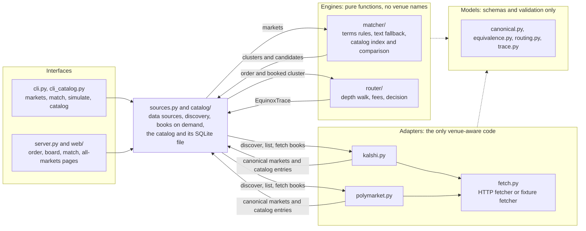

# Project Equinox

Equinox compares prediction markets across venues. It reads Kalshi and Polymarket through their public APIs, turns each venue's markets into one venue-neutral shape, and groups markets that pay out under exactly the same conditions. Then it simulates a hypothetical order on every market in a group and picks the cheapest venue that can fill it, fees and order-book depth included. Every decision comes with a written explanation: why the markets were matched, what each venue would cost, why a venue was excluded, and what could still go wrong.

It is an infrastructure prototype, not a trading product. Nothing is bought or sold. The only thing Equinox saves is its catalog of open markets, which it can rebuild at any time (D48).

## Run it

Needs Python 3.12.

**Windows** (no `make`; [uv](https://docs.astral.sh/uv/) provides Python 3.12):

```powershell
uv venv --python 3.12 .venv
uv pip install --python .venv -r requirements.txt
.venv\Scripts\python scripts\gate.py
$env:PYTHONPATH = "src"
.venv\Scripts\python -m equinox simulate --market kalshi:KXFEDDECISION-26OCT-H0 --outcome YES --quantity 100 --source fixtures
```

**macOS and Linux** (needs the standard `venv` module; on Debian and Ubuntu that is `python3-venv`):

```bash
make install
make gate
PYTHONPATH=src .venv/bin/python -m equinox simulate --market kalshi:KXFEDDECISION-26OCT-H0 --outcome YES --quantity 100 --source fixtures
```

`scripts/gate.py` is the one check: ruff lint, ruff format, then the tests. No test touches the network.

### Commands

| Command | What it prints |
|---|---|
| `python -m equinox markets` | Every canonical market: its contract terms in words, whether it is tradable, and the best ask for YES and NO |
| `python -m equinox match` | Groups of equivalent markets with their risk flags, then the pairs that are only AMBIGUOUS, with reasons |
| `python -m equinox simulate --market ID --outcome YES\|NO --quantity N [--budget B]` | The routing decision: a quote per venue, the winner, the rationale and every warning |
| `python -m equinox catalog refresh` | Reads every open market on both venues, compares every cross-venue pair it can, and saves the result (see below) |
| `python -m equinox catalog status` | The saved catalog's age and counts |
| `python -m equinox match --catalog` | `match`, plus the catalog's summary and its 20 most similar unclear pairs |
| `python -m equinox catalog read --limit N` | Has a model read the terms of up to N markets in unclear pairs; checks and rules decide them (see below) |

Each command takes `--source live` (the default) or `--source fixtures`, and `--json` to print the full result instead of a report. `simulate` exits with a code per outcome: 0 routed, 1 market not found, 2 not enough liquidity, 3 over budget, 4 bad input, 5 no venue can take the order (D27).

Equinox finds the markets itself (D47). For each event family it can read, today Fed rate decisions, it asks each venue for every open event: Kalshi by its `KXFEDDECISION` series, Polymarket by its `fed-rates` tag, keeping only open "Fed Decision in …?" events. On 2026-10-11 that was 11 meetings on Kalshi and 3 on Polymarket, and the three meetings both list (October, December, January) are matched outcome by outcome. Order books are read only for the group being priced (D49).

`--source fixtures` reads a saved snapshot, so the numbers below never change. `--snapshot NAME` picks one: `snapshot-2026-10-10` (the default) holds the October meeting only and predates discovery, so it uses the pinned events in `src/equinox/tracked_events.json` and says so; `snapshot-2026-10-11` holds every meeting discovery found. `--source live` reads the venues' public APIs; a live run on 2026-10-10 loaded every market and routed the first demo order the same way. If a venue fails during a live run, its markets come from the snapshot and the output says so (D17).

### Every open market

`python -m equinox catalog refresh` reads every open market on Kalshi and Polymarket, compares them, and saves the result in `.cache/equinox/` (git ignores it; `EQUINOX_CACHE_DIR` moves it). The recorded refresh on 2026-10-11 read 287,523 markets in 286 requests: a 151 MiB download (gzip) and 158 seconds in all. It needs about 400 MB of free memory; that run peaked at 383 MiB, and the saved file was 110 MB. If any request fails after two retries, the refresh stops and the previous catalog is kept (D55). `--source fixtures --snapshot snapshot-2026-10-11` builds one from that snapshot's small sample instead: 840 markets, in under a second. The older default snapshot holds no sample.

Of the 287,523 markets in that refresh, 15 outcomes are the same bet on both venues (the Fed meetings both list) and can be priced. 10,957 pairs have similar titles but no readable terms: they are shown as unclear and never routed. [docs/EQUIVALENCE.md](docs/EQUIVALENCE.md) has every count and examples of both.

### Reading terms with a model

Titles alone can't be routed, so `python -m equinox catalog read --limit 100` has a model (`claude-haiku-5-5`) read the markets in unclear pairs into contract terms. Deterministic checks refuse any reading the venue's own text doesn't support, and the same rules that match Fed markets decide (D57). It needs `ANTHROPIC_API_KEY` in the environment or in `.env` at the repository root (git ignores it). 100 markets cost about 47,000 input and 14,000 output tokens; answers are cached, so a re-run pays only for changed text. The command prints what it spent.

A same bet the model read can be priced like a Fed outcome, with `simulate --market` or from the All markets page, but only while the recorded evals show no false same-bet; its trace says the terms were read by a model. On 2026-10-11, 10 YES on Mbappé winning the 2026 Ballon d'Or routed to Polymarket at $0.22 against $0.33 on Kalshi.

`python -m equinox.reader.evals` scores the reader on three gold sets (the Fed meetings, hand-labelled pairs, and held-out pairs). On the recorded run it found 24 of 32 same bets with no false same-bet. The tests replay that run, so no test calls the model. [docs/EQUIVALENCE.md](docs/EQUIVALENCE.md) has the numbers and what a live sample found.

### The web UI

```powershell
$env:PYTHONPATH = "src"
.venv\Scripts\python -m equinox.server
```

Then open http://127.0.0.1:8741 (on macOS and Linux, `make run`). Four pages, built from the user stories in [user/users.md](user/users.md):

- **Price an order.** Pick an outcome, buy YES or NO, the number of contracts and an optional budget. The answer comes first: which venue, what it costs including fees, how much it saves. Below it: why, what each venue would cost or why it can't take the order, and whether the venues are really offering the same bet.
- **Market board.** Every outcome with both venues' prices side by side, how sure Equinox is that they are the same bet, and the best venue for 100 YES and for 100 NO.
- **Why these match.** Each venue's rules side by side, with the differences marked, the verdict, its confidence level and every pair that was set aside as unclear.
- **All markets.** Search every open market in the saved catalog by title words, filtered by venue and by status: same bet (with a link that prices it), unclear (with the title score and the reasons it is never routed), or no match found. With no catalog, it shows the command that builds one.

The banner lets you pick the data: either snapshot, or live prices. On `snapshot-2026-10-11` or live data the board shows every Fed meeting both venues list, one table per meeting. Outcome names give basis points in percentage points too, e.g. "Cut 25 bps (0.25 percentage points)". They call the same code as the command line, so the two always agree, and a test checks it. `/health` returns the server's status as JSON. Architecture §8.3 has the details (D45).

## Demo

All rows use the snapshot. The running example is "Will the Fed hold rates at its October 27–28, 2026 meeting?": Kalshi `KXFEDDECISION-26OCT-H0` and Polymarket `2589812` ("No change").

<!-- demo:start -->
| Command | Exit | Result |
|---|---|---|
| `python -m equinox markets --source fixtures` | 0 | 10 markets: 5 on Kalshi and 5 on Polymarket |
| `python -m equinox match --source fixtures` | 0 | 5 clusters, each one Kalshi market and one Polymarket market |
| `python -m equinox simulate --market kalshi:KXFEDDECISION-26OCT-H0 --outcome YES --quantity 100 --source fixtures` | 0 | ROUTED to `polymarket:2589812`: $84.672 against $85.90 on Kalshi |
| `python -m equinox simulate --market kalshi:KXFEDDECISION-26OCT-H0 --outcome NO --quantity 100 --source fixtures` | 0 | ROUTED to `kalshi:KXFEDDECISION-26OCT-H0`: $16.95 against $17.7055 on Polymarket |
| `python -m equinox simulate --market kalshi:KXFEDDECISION-26OCT-H0 --outcome NO --quantity 5000 --source fixtures` | 0 | ROUTED to `polymarket:2589812`: $885.275 against $893.7951 on Kalshi, whose order spills onto a second price level |
| `python -m equinox simulate --market kalshi:KXFEDDECISION-26OCT-H0 --outcome YES --quantity 100 --budget 80 --source fixtures` | 3 | BUDGET_EXCEEDED: both venues can fill it, for $84.672 and $85.90 |
| `python -m equinox simulate --market kalshi:KXFEDDECISION-26OCT-H0 --outcome YES --quantity 5000000 --source fixtures` | 2 | INSUFFICIENT_LIQUIDITY: neither book holds 5,000,000 YES contracts |
| `python -m equinox simulate --market kalshi:KXFEDDECISION-26OCT-C25 --outcome NO --quantity 100 --source fixtures` | 0 | ROUTED to `polymarket:2589811`: $99.61992, while nobody on Kalshi is selling NO |
| `python -m equinox simulate --market kalshi:NOPE --outcome YES --quantity 1 --source fixtures` | 1 | MARKET_NOT_FOUND |
| `python -m equinox simulate --market kalshi:KXFEDDECISION-26OCT-H0 --outcome YES --quantity 0 --source fixtures` | 4 | INVALID_INPUT |
| `python -m equinox markets --source fixtures --snapshot snapshot-2026-10-11` | 0 | 70 markets: 55 on Kalshi (11 meetings) and 15 on Polymarket (3 meetings), all found by discovery |
| `python -m equinox simulate --market kalshi:KXFEDDECISION-26DEC-H0 --outcome YES --quantity 100 --source fixtures --snapshot snapshot-2026-10-11` | 0 | ROUTED to `polymarket:3215007` (December, no change): $23.8855 against $27.63 on Kalshi, whose 26¢ level holds only 73 contracts |
| `python -m equinox simulate --market kalshi:KXFEDDECISION-26DEC-H0 --outcome NO --quantity 100 --source fixtures --snapshot snapshot-2026-10-11` | 0 | ROUTED to `kalshi:KXFEDDECISION-26DEC-H0`: $76.9691 against $78.858 on Polymarket |
<!-- demo:end -->

`tests/test_docs.py` runs every row above and checks the exit code, status, winner and each dollar amount against the code. A number in this table that stops matching fails the gate.

The rows with 100 NO and 5,000 NO pick different venues for the same market. Kalshi's best NO price holds only 534.49 contracts, so a 5,000-contract order walks into its next level, and fees are charged level by level. Priced at Kalshi's best level alone, the order would look like $847.04 and win, which is wrong. [docs/ROUTING.md](docs/ROUTING.md) works through it.

## How it works



| Module | Owns | Rule it keeps |
|---|---|---|
| `models/` | Every shape that crosses a module boundary, and its validation | No I/O and no venue names. Money is `Decimal`, never a float (D3). |
| `adapters/` | Venue URLs, field names, units, sort orders, and the parsers that turn a venue's wording into contract terms | Everything leaves fully normalized: prices in dollars, both outcomes' books sorted best-first, terms filled in where the event family has a parser. |
| `matcher/` | Equivalence rules, clusters and confidence; for the catalog, the title index and the comparison of every market | Pure. Imports only `models/`. Names no venue. |
| `router/` | The depth walk, fees, eligibility, the decision, the rationale and the trace | Pure. Imports only `models/`. Names no venue. Time comes in as an argument. |
| `sources.py` | Settings, data sources (snapshots and live), discovery, books on demand | Wires adapters, matcher and router together for both interfaces. |
| `catalog/` | Reading every open market, comparing them, and the saved SQLite file | A failed refresh keeps the previous catalog. |
| `cli.py`, `cli_catalog.py` | Arguments, output, exit codes | No loading logic of its own. |
| `server.py`, `web/` | The web UI's four pages and `/health` | Renders what the matcher and router decide, through `sources.py` and `catalog/`. No matching or routing logic of its own. |

The brief asks that routing logic contain no venue-specific assumptions. `tests/test_layering.py` checks it on every run: it fails if `matcher/` or `router/` imports anything but the models, the standard library and pydantic, or if the word "kalshi", "polymarket" or "meridian" appears in their code. Venue names reach the output only through each market's own `venue` field.

A new venue is one adapter file (how to discover, list and fetch books), a fixture, and one line in the adapter registry in `src/equinox/sources.py`. [docs/architecture.md](docs/architecture.md) §9 checks that against a third venue, Meridian, without integrating it: hand-built Meridian-style markets go through the real matcher and router in the test suite.

The full design is [docs/architecture.md](docs/architecture.md).

## Reading the code

Each module has one job, stated at its top. Where to look for each part of the logic:

| Question | Where |
|---|---|
| How is a venue read, and its wording turned into contract terms? | `src/equinox/adapters/kalshi.py`, `src/equinox/adapters/polymarket.py` |
| What does a canonical market look like, and what does the model refuse? | `src/equinox/models/canonical.py` |
| How is "the same bet" decided? | `src/equinox/matcher/terms.py` (the rules), `src/equinox/matcher/clusters.py` (grouping), `src/equinox/matcher/text.py` (the title fallback) |
| How sure is each match? | `src/equinox/matcher/confidence.py` |
| How is a venue chosen, and the cost worked out? | `src/equinox/router/depth.py` (walking the book), `src/equinox/router/engine.py` (eligibility and the decision) |
| Where is the explanation written? | `src/equinox/router/rationale.py` |
| Where do markets come from: live data or a snapshot? | `src/equinox/sources.py` |
| How is every open market read and compared? | `src/equinox/catalog/__init__.py` (the refresh), `src/equinox/matcher/index.py` (finding candidates), `src/equinox/matcher/compare.py` (same bet, unclear, no match), `src/equinox/catalog/store.py` (the saved file) |
| How does a model read terms, and what stops a wrong reading? | `src/equinox/reader/prompt.py` (what is asked), `src/equinox/reader/checks.py` (what is refused), `src/equinox/reader/run.py` (reading the catalog), `src/equinox/reader/evals.py` (the gold sets), `src/equinox/reader/pricing.py` (when a model-read pair may be routed) |
| How do the command line and the web pages present it? | `src/equinox/cli.py`, `src/equinox/cli_catalog.py`, `src/equinox/web/order.py`, `src/equinox/web/board.py`, `src/equinox/web/match.py`, `src/equinox/web/markets.py` |
| Which tests pin the rules? | `tests/test_matcher.py` (the labelled pairs), `tests/test_router.py` (every status), `tests/test_index.py` (catalog candidates and statuses), `tests/test_docs.py` (this README's numbers) |

The engines in `matcher/` and `router/` import only the models and never name a venue; `tests/test_layering.py` checks that on every run. `tests/test_quality.py` keeps modules under 300 lines and functions under 40, and keeps the command line and the web UI from depending on each other (D52).

## Equivalence and routing, in brief

**Equivalence** ([docs/EQUIVALENCE.md](docs/EQUIVALENCE.md)). Two markets are equivalent only if holding YES on one pays out under exactly the same real-world conditions as holding YES on the other (D8). Equinox decides that from structured contract terms (what is measured, how, when, the comparison and the threshold), not from how similar the titles are (D15). Differences that remain, such as how each venue breaks a tie or handles a cancelled meeting, are attached as risk flags and carried into every routing explanation. A pair whose terms can't be read is at most AMBIGUOUS and is never routed.

**Routing** ([docs/ROUTING.md](docs/ROUTING.md)). For one order, every market in the group is simulated: walk the order book from the cheapest ask, charge each venue's own fee formula level by level, and record every reason the venue can't take the order. The cheapest venue that can fill the whole order within budget wins (D6, D7). The trace says why, what each venue would have cost, and what the match risks are.

## Why Python

The brief notes that PEAK6 often uses Go on Google Cloud and allows other tools when justified. Equinox is a local, single-process prototype: one command at a time, about 30 HTTP requests to price an order, and 286 to read every open market into a SQLite file (D1, D48, D53). Python's standard library covers the HTTP client, exact decimal arithmetic and time zones, and `pydantic` gives the canonical model its validation. The repository and both CI configurations were already set up for Python 3.12. Clarity of the matching and routing logic mattered more here than the runtime.

## Where the reasoning is

- [docs/DECISIONS.md](docs/DECISIONS.md): every decision with its reason and trade-off, the assumptions A1–A5, and what was cut.
- [docs/research/venue_facts.md](docs/research/venue_facts.md): what each venue actually does, each fact with a source and a CONFIRMED, SECONDARY or UNCONFIRMED label.
- [docs/AI_USAGE.md](docs/AI_USAGE.md): how AI was used, and every place it misled us and how that was caught.
- [docs/features/](docs/features/): the build plan, one PRD per lane, with its acceptance tests.

## Known limitations

Architecture §13 lists them with their reasons. In short:

- One event family has a term parser: Fed rate decisions. Every other market can only be matched by text, so it is never routed.
- The catalog is as fresh as its last refresh, and a title pair is found only if the markets close within 3 days and share two informative words (D50).
- Discovery rules are written per venue and family (D47): a venue that renames its series or tag needs a code change, and until then live runs use the pinned events.
- Order books are treated as frozen at capture (A2). One order goes to one venue; there is no split routing.
- Fees are list fees: Polymarket's taker rebates are ignored (A5), and Kalshi fees are rounded up to the cent (A3).
- Meridian is not integrated; §9 shows that a venue like it would fit.

## Hosts and CI

One codebase on two hosts. Every push goes to both remotes with one explicit command each: `git push origin <branch>` and `git push github <branch>`, or `make push-hosts` for the current branch. On a fresh clone, `scripts/link-hosts.sh <github-url> <gitlab-url>` sets up both remotes.

| Host | Git remote | CI |
|---|---|---|
| GitLab ([labs.gauntletai.com](https://labs.gauntletai.com/calebtagoe/project-equinox)) | `origin` | [`.gitlab-ci.yml`](.gitlab-ci.yml) |
| GitHub ([joshuatagoe/project-equinox](https://github.com/joshuatagoe/project-equinox)) | `github` | [`.github/workflows/ci.yml`](.github/workflows/ci.yml) |

GitHub Actions is the CI of record: it runs `scripts/gate.py` on pull requests and on `main`. GitLab runs the same job only when a project runner is registered and the CI/CD variable `EQUINOX_GITLAB_RUNNER` is set, because labs.gauntletai.com gives this project no shared runners (D40).
