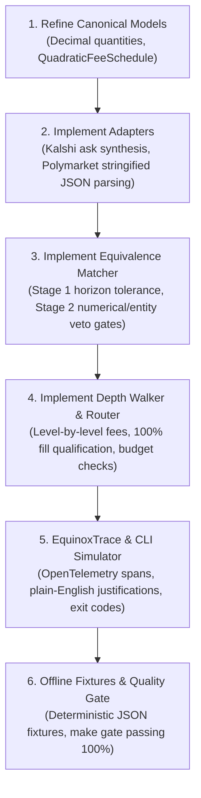

# Project Equinox: Independent Lead Architectural Review & Technical Evaluation

> **2026-10-10: read with care.** This review cites no sources. Its structural findings became D3–D7. Seven of its venue facts are wrong, and they are listed with sourced corrections in [research/venue_facts.md](research/venue_facts.md#where-docsarchitectural_reviewmd-is-wrong). It is kept as a record of the first design pass (see AI_USAGE.md items 1 and 6).

**Author:** Lead Principal Systems Architect & Peer Reviewer  
**Date:** October 2026  
**Document Evaluated:** `docs/prd.md` (Product Requirements Document), `user/users.md` (Domain Personas & Workflows)  
**Target Repositories:** GitHub / GitLab (`project-equinox`)  
**CI/Quality Gate:** `make gate` (Ruff linting/formatting, Pytest offline fixtures)

---

## 1. Executive Summary

Project Equinox proposes an infrastructure prototype for cross-venue prediction market aggregation, normalization, equivalence detection, and intelligent order routing across **Polymarket** and **Kalshi**. 

This independent architectural review conducted an exhaustive, ground-truth audit of the design decisions in `docs/prd.md` against real-world exchange mechanics, official public API specifications (Polymarket Gamma/CLOB APIs and Kalshi `trade-api/v2`), market microstructure realities, and edge cases in contract resolution.

### Summary Scorecard

| # | Architectural Decision Area | Verdict | Primary Finding / Critical Real-World Nuance |
|---|---|:---:|---|
| 1 | **Separation of Concerns** | **CONFIRMED** | Clean 5-layer decoupled design; adapter boundary properly protects router from venue logic. Needs explicit contract outcome modeling. |
| 2 | **Canonical Data Models** | **CHALLENGED** | `quantity: int` breaks Polymarket's fractional share sizes and Kalshi fixed-point sizes. Gamma returns stringified JSON arrays. |
| 3 | **Fee Calculation Engine** | **DENIED** | **Fatal Flaw:** Real Kalshi and Polymarket taker fees are quadratic variance curves ($P(1-P)$), NOT flat cents or volume percentages. Calculating fees on VWAP violates Jensen's Inequality. |
| 4 | **Equivalence 3-Stage Pipeline** | **CHALLENGED** | Hard 24h expiration delta causes false negatives on macro markets. Stage 2 linear scoring lacks a veto gate, causing dangerous false positives on numerical strikes (25 bps vs 50 bps) and bracket vs threshold payout mismatches. |
| 5 | **Routing & Depth-Walking Algorithm** | **CHALLENGED** | Kalshi API v2 returns **BIDS ONLY**; asks must be mathematically derived ($1.00 - P_{\text{NO Bid}}$). Missing explicit rules for partial fill ranking and `max_budget` enforcement. |
| 6 | **Observability & Audit Trace Schema** | **CONFIRMED** | Hierarchical OpenTelemetry-style spans provide excellent auditability for Personas (Jordan & Morgan). |
| 7 | **Data Imperfection & Degradation Handling** | **CONFIRMED** | Sound fallback for missing depth and offline CI fixtures. Requires explicit staleness threshold and division-by-zero protection on empty books. |

---

## 2. Deep-Dive Evaluations by Architectural Decision

```
┌─────────────────────────────────────────────────────────────────────────────────────────────┐
│                                ARCHITECTURAL AUDIT PIPELINE                                 │
├──────────────────────────────┬──────────────────────────────┬───────────────────────────────┤
│ [1] Separation of Concerns   │ [2] Canonical Data Models    │ [3] Fee Calculation Engine    │
│ Verdict: CONFIRMED           │ Verdict: CHALLENGED          │ Verdict: DENIED               │
├──────────────────────────────┼──────────────────────────────┼───────────────────────────────┤
│ [4] Equivalence 3-Stage      │ [5] Routing & Depth Walker   │ [6] Observability Trace       │
│ Verdict: CHALLENGED          │ Verdict: CHALLENGED          │ Verdict: CONFIRMED            │
├──────────────────────────────┴──────────────────────────────┴───────────────────────────────┤
│ [7] Data Imperfection & Graceful Degradation: CONFIRMED                                     │
└─────────────────────────────────────────────────────────────────────────────────────────────┘
```

---

### Decision 1: Separation of Concerns & Boundary Layer
* **Verdict:** **[CONFIRMED]**
* **PRD Proposal:**
  * Strict 5-layer separation: Layer 1 (Adapters) $\to$ Layer 2 (Canonical Normalizer) $\to$ Layer 3 (Equivalence Matcher) $\to$ Layer 4 (Venue-Agnostic Router) $\to$ Layer 5 (Observability & CLI/API).
  * The routing engine contains **zero venue-specific code** (`if venue == ...` is strictly prohibited).
  * Venue-specific data is isolated in a "junk drawer" `venue_metadata: dict[str, Any]` on the canonical market.

#### Architectural Assessment & Ground-Truth Verification
* **Strengths:** 
  * Applying the Ports and Adapters (Hexagonal) pattern is the gold standard for multi-exchange financial routing. Decoupling the router from exchange-specific quirks ensures horizontal scalability as future venues (e.g., PredictIt, Betfair, Manifold) are onboarded.
  * Encapsulating fee logic behind a standardized method call (`fee_schedule.calculate_taker_fee`) preserves domain purity in the routing engine.
* **Identified Blind Spot & Gap:**
  * **Outcome Token Mapping Asymmetry:**
    * Polymarket represents `YES` and `NO` as two separate on-chain ERC-1155 asset tokens (`clobTokenIds`), each having its own independent order book with bids and asks.
    * Kalshi represents binary markets as a single market ticker with a unified book quoting `yes_dollars` bids and `no_dollars` bids.
    * If `CanonicalMarket` only holds a single `order_book: CanonicalOrderBook` without specifying *which* outcome that book belongs to, how does the router execute an order for `outcome: NO` without knowing venue-specific mechanics?
* **Required Refinements:**
  1. Define `CanonicalMarket` as representing a specific tradable contract outcome (e.g. `canonical_id = "POLY-0x123-YES"` and `outcome = "YES"`), OR equip `CanonicalMarket` with a dictionary of normalized books: `order_books: dict[str, CanonicalOrderBook] = {"YES": ..., "NO": ...}`.
  2. The boundary adapter MUST completely normalize order books into standard bids and asks for the target outcome *before* returning canonical entities, keeping the router 100% agnostic.

---

### Decision 2: Canonical Data Models Specification
* **Verdict:** **[CHALLENGED]**
* **PRD Proposal:**
  * `OrderBookLevel`: `price: Decimal` (range $[0.00, 1.00]$), `quantity: int` ($> 0$).
  * `CanonicalOrderBook`: `bids: list[OrderBookLevel]`, `asks: list[OrderBookLevel]`, `depth_available: bool`.
  * `CanonicalMarket`: Standard fields with ISO UTC datetimes and `venue_metadata`.

#### Architectural Assessment & Ground-Truth Verification
* **Flaw 1: Integer Quantity Assumption (`quantity: int`):**
  * **Polymarket CLOB Reality:** Order book sizes on Polymarket CLOB are decimal quantities (e.g., `min_order_size = "5.0"`, sizes reported as strings like `"1500.50"` or `"4200.25"`). Polymarket supports fractional outcome shares.
  * **Kalshi v2 Reality:** Kalshi’s modern fixed-point API returns contract counts as fixed-point decimal strings (`"count_fp": "13.00"` or `"volume_fp": "25042.00"`).
  * **Impact:** Typing `quantity` as `int` in Pydantic will reject valid Polymarket orders or truncate fractional shares, causing precision leakage and test failures.
* **Flaw 2: Polymarket Stringified JSON Structures:**
  * The Gamma API (`GET /markets`) returns `clobTokenIds`, `outcomes`, and `outcomePrices` as **stringified JSON arrays** (e.g., `"[\"8501...\", \"8501...\"]"` and `"[\"Yes\", \"No\"]"`), NOT native JSON lists.
  * Furthermore, `token_id` is NOT a top-level field in `GET /markets`; it must be parsed from `json.loads(market["clobTokenIds"])[0]`.
* **Flaw 3: Kalshi Price Migration:**
  * Kalshi deprecated integer cents (`yes_bid: 48`) across `trade-api/v2`. All live pricing is returned as fixed-point dollar strings (`yes_bid_dollars: "0.4800"`). The adapter must parse dollar strings directly rather than dividing integer cents by 100.
* **Required Refinements:**
  1. Update `OrderBookLevel`:
     ```python
     class OrderBookLevel(BaseModel):
         price: Decimal = Field(..., ge=Decimal("0.00"), le=Decimal("1.00"))
         quantity: Decimal = Field(..., gt=Decimal("0.00"))
     ```
  2. Implement explicit deserialization hooks in `PolymarketAdapter` to unpack stringified JSON fields safely.
  3. All monetary calculations (prices, quantities, costs, fees) must strictly use `Decimal` with explicit rounding contexts.

---

### Decision 3: Fee Calculation Engine
* **Verdict:** **[DENIED]**
* **PRD Proposal:**
  * `CanonicalFeeSchedule` enum: `Literal["fixed_per_contract", "percentage_volume", "zero"]`.
  * Assumes Kalshi charges a flat $0.01 per contract fee (`fixed_per_contract`).
  * Assumes Polymarket charges a flat volume percentage or zero (`percentage_volume` / `zero`).
  * Computes fee at the end of routing using order VWAP: $\text{Fee} = \text{calculate\_taker\_fee}(N, \bar{P})$.

#### Architectural Assessment & Ground-Truth Verification
* **Fatal Flaw 1: Kalshi Fee Model is Quadratic ($P(1-P)$), NOT Flat Cents:**
  * Kalshi's CFTC regulatory taker fee schedule uses a quadratic formula:
    $$\text{Fee} = \left\lceil M \times 0.07 \times C \times P \times (1 - P) \right\rceil$$
    Where $M = 1.0$ (standard contract multiplier), $C$ is contract quantity, and $P$ is dollar price ($0.01 \le P \le 0.99$).
  * The fee reaches its maximum at $P = \$0.50$ ($1.75\text{¢}$ per contract) and decreases to $\approx 0.63\text{¢}$ at $P = \$0.10$ or $\$0.90$.
  * Kalshi enforces a ceiling function rounding UP to the nearest integer cent per order.
  * **Result:** Kalshi does **NOT** charge a flat $\$0.01$ per contract. The PRD’s enum is incapable of representing Kalshi's real fee structure.
* **Fatal Flaw 2: Polymarket Taker Fee Model is ALSO Quadratic ($P(1-P)$):**
  * Polymarket operates dynamic category-based taker fees:
    $$\text{Fee} = \Theta \times C \times P \times (1 - P)$$
    Where $\Theta \approx 0.04$ to $0.10$ depending on category (politics, finance, sports), and $\Theta = 0.00$ for fee-exempt categories (geopolitics/macro).
  * Polymarket does **NOT** charge a flat percentage volume fee.
* **Fatal Flaw 3: Mathematical Fallacy of Fee on VWAP (Jensen’s Inequality):**
  * Section 7.1 computes: $\text{Fee} = \text{calculate\_taker\_fee}(N, \bar{P})$, where $\bar{P}$ is the Volume-Weighted Average Price.
  * For linear fee models ($C \times P \times \text{rate}$), calculating on VWAP is mathematically equivalent to level-by-level fees.
  * BUT because the quadratic function $f(P) = P(1 - P) = P - P^2$ is **strictly concave** ($f''(P) = -2 < 0$), **Jensen’s Inequality** dictates:
    $$\mathbb{E}[P(1 - P)] < \bar{P}(1 - \bar{P}) \quad \text{for any non-degenerate price distribution}$$
  * Calculating quadratic fees on VWAP across multiple book levels systematically **overestimates** the taker fee compared to actual exchange settlement!
* **Required Refinements:**
  1. Replace the rigid `CanonicalFeeSchedule` enum with an extensible model supporting quadratic variance fees:
     ```python
     class CanonicalFeeSchedule(BaseModel):
         venue: str
         fee_type: Literal["fixed_per_contract", "percentage_volume", "quadratic_variance", "zero"]
         rate: Decimal = Decimal("0.00")
         multiplier: Decimal = Decimal("1.0")
         round_to_cents: bool = False

         def calculate_taker_fee(self, quantity: Decimal, price: Decimal) -> Decimal:
             if self.fee_type == "quadratic_variance":
                 raw_fee = self.multiplier * self.rate * quantity * price * (Decimal("1.0") - price)
                 if self.round_to_cents:
                     # Kalshi ceiling round-up to nearest cent:
                     return (raw_fee * Decimal("100")).to_integral_value(rounding=ROUND_CEILING) / Decimal("100")
                 return raw_fee
             elif self.fee_type == "fixed_per_contract":
                 return self.rate * quantity
             elif self.fee_type == "percentage_volume":
                 return quantity * price * self.rate
             return Decimal("0.00")
     ```
  2. **Level-by-Level Fee Accumulation:** During depth walking, compute and accumulate fees at each fill level $(Q_i, P_i)$ rather than approximating over the final VWAP:
     $$\text{Total Fee} = \sum_{i=1}^{k} \text{calculate\_taker\_fee}(Q_i, P_i)$$

---

### Decision 4: Equivalence Detection Engine (3-Stage Hybrid Pipeline)
* **Verdict:** **[CHALLENGED]**
* **PRD Proposal:**
  * Stage 1: Hard Filters ($|\text{Exp}_A - \text{Exp}_B| \le 24\text{ hours}$ and affirmative polarity).
  * Stage 2: Heuristic & Semantic Scoring ($S = 0.50 \cdot S_{\text{entity}} + 0.30 \cdot S_{\text{token}} + 0.20 \cdot S_{\text{fuzzy}}$).
  * Stage 3: Classification ($S \ge 0.85$ EQUIVALENT, $0.60 \le S < 0.85$ AMBIGUOUS, $< 0.60$ DISTINCT) with oracle risk flags.

#### Architectural Assessment & Ground-Truth Verification
* **Vulnerability 1: The 24-Hour Expiration Delta Filter Trap:**
  * In macroeconomic and event-driven markets, Kalshi anchors `expiration_time` to the exact event announcement (e.g. FOMC meeting on September 18 at 18:00 UTC).
  * Polymarket frequently anchors `endDate` to the final calendar day of the month (e.g. September 30 at 23:59 UTC).
  * This creates a 12-day expiration delta. The PRD’s rigid $\le 24\text{h}$ hard filter immediately rejects the pair as `DISTINCT`, causing a **critical false negative** on the most actively traded equivalent markets.
* **Vulnerability 2: Fatal Blind Spot in Stage 2 Linear Scoring (Lack of Veto Gates):**
  * The formula $S = 0.50 \cdot S_{\text{entity}} + 0.30 \cdot S_{\text{token}} + 0.20 \cdot S_{\text{fuzzy}}$ averages out token overlap and fuzzy similarity.
  * **Concrete Failure Case A (Numerical Strike Mismatch):**
    * Market A: *"Will the Fed cut rates by 25 bps?"*
    * Market B: *"Will the Fed cut rates by 50 bps?"*
    * Token overlap is $\approx 85\%$, fuzzy string similarity is $\approx 92\%$, entity overlap on Fed/rates is high.
    * Under the PRD formula, $S > 0.85 \implies \mathbf{EQUIVALENT}$!
    * Yet these two markets are **mutually exclusive** real-world events! A cross-market hedge here guarantees a 100% loss on one side.
  * **Concrete Failure Case B (Geographic Entity Mismatch):**
    * Market A: *"Will Trump win Pennsylvania in 2024?"*
    * Market B: *"Will Trump win Michigan in 2024?"*
    * Overlap is $> 80\%$, yielding an `AMBIGUOUS` classification when it is factually `DISTINCT`.
* **Vulnerability 3: Contract Payout Topology (Brackets vs Cumulative Thresholds):**
  * Kalshi Fed rate markets (`FED-24SEP`) are structured as **cumulative thresholds** ($\ge 25\text{ bps}$, $\ge 50\text{ bps}$). When the Fed cut by 50 bps in Sept 2024, BOTH contracts resolved to YES ($1.00).
  * Polymarket Fed rate markets are structured as **mutually exclusive categorical brackets** (`"25 bps cut"`, `"50 bps cut"`, `"No change"`). When the Fed cut by 50 bps, `"25 bps cut"` resolved to NO ($0.00).
  * Treating categorical bracket tokens as binary threshold contracts causes catastrophic arbitrage loss.
* **Required Refinements:**
  1. **Adaptive Temporal Filter:** 
     * If both titles contain the same calendar month or event cycle (e.g., `"September 2024"` or `"December 2025"`), allow a relaxed horizon tolerance ($\pm 31\text{ days}$).
     * If dates mismatch outside 24 hours without matching horizon entities, degrade the pair to `AMBIGUOUS` with a `temporal_divergence` flag rather than hard rejection.
  2. **Mandatory Veto Gates in Stage 2 (Disqualifiers):**
     * Introduce a deterministic pre-scoring Veto Filter. Even if text overlap is 99%, the pair is immediately marked `DISTINCT` if:
       - **Numeric Metric Contradiction:** Extracted numbers/thresholds differ (e.g. $25\text{ bps} \ne 50\text{ bps}$, $4.5\% \ne 4.75\%$).
       - **Entity Contradiction:** Conflicting states (PA vs MI), candidates, or institutions.
       - **Payout Topology Conflict:** Categorical bracket vs cumulative threshold.
  3. **Deterministic Entity Extractor:** Implement a lightweight, rule-based entity extractor (Domain Regex + Keyword Dictionaries: Actors, Targets, Metrics, Horizons) to guarantee deterministic execution in CI without external network calls or heavy LLM models.

---

### Decision 5: Venue-Agnostic Routing & Depth-Walking Algorithm
* **Verdict:** **[CHALLENGED]**
* **PRD Proposal:**
  * Walks ask levels $(P_i, Q_i)$ to fill quantity $N$.
  * Calculates VWAP: $\bar{P} = \text{base\_cost} / N_{\text{filled}}$.
  * Calculates Slippage: $\bar{P} - P_{\text{best\_ask}}$.
  * Selects candidate minimizing `Total Net Cost`.

#### Architectural Assessment & Ground-Truth Verification
* **Critical Flaw 1: Missing Ask Derivation in Kalshi Order Books:**
  * As verified via Kalshi’s official `trade-api/v2/markets/{ticker}/orderbook`, Kalshi returns **BIDS ONLY** (`yes_dollars` and `no_dollars`).
  * In binary prediction markets, buying YES at Ask price $P$ is equivalent to executing against NO Bids at price $1.00 - P$.
  * If the Kalshi adapter does not synthesize YES asks:
    $$P_{\text{YES Ask}} = 1.00 - P_{\text{NO Bid}}, \quad Q_{\text{YES Ask}} = Q_{\text{NO Bid}}$$
    (sorted ascending by ask price), the depth walker will encounter an empty ask book and fail with `INSUFFICIENT_LIQUIDITY` on every Kalshi market!
* **Critical Flaw 2: Partial Fill Ranking Ambiguity:**
  * Consider Order: `Buy 100 YES`.
    * Venue A has only 40 contracts available at $\$0.48 \implies \text{Total Cost} = \$19.20$ (40% fill).
    * Venue B has 100 contracts available at $\$0.50 \implies \text{Total Cost} = \$50.00$ (100% fill).
  * If the routing engine naively compares `Total Net Cost`, Venue A's $\$19.20 < \$50.00$, but Venue A failed to satisfy the user's order!
  * The PRD states: *"Winning Venue: Candidate minimizing Total Net Cost for the full quantity."* But it leaves undefined how candidates are handled when NO venue reaches 100%, or when partial fills occur.
* **Critical Flaw 3: Unenforced `max_budget` Parameter:**
  * The order request includes `max_budget: B`, but Section 7.1 never checks whether $\text{Total Net Cost} \le B$.
* **Required Refinements:**
  1. **Synthetic Ask Reconstruction:** The `KalshiAdapter` MUST convert `no_dollars` bids into synthetic YES asks, reversing the price sort:
     ```python
     # Kalshi NO bids: [["0.4200", "80.00"], ["0.4400", "250.00"]]
     # Derived YES asks: [OrderBookLevel(price=0.56, quantity=250), OrderBookLevel(price=0.58, quantity=80)]
     ```
  2. **Liquidity Qualification Rule:** 
     * Only candidate venues that achieve **100% fill** ($N_{\text{filled}} == N$) are eligible for winning venue selection based on net cost.
     * If NO candidate reaches 100% fill, the simulator must abort selection, return status `INSUFFICIENT_LIQUIDITY`, emit CLI exit code `2`, and provide side-by-side partial fill statistics.
  3. **Budget Guardrail:** If $\text{Total Net Cost} > \text{max\_budget}$, the venue must be marked `BUDGET_EXCEEDED` and disqualified from winning.

---

### Decision 6: Observability & Audit Trace Schema (`EquinoxTrace`)
* **Verdict:** **[CONFIRMED]**
* **PRD Proposal:**
  * Structured JSON audit trace with `trace_id`, `timestamp_utc`, `assumptions`, and hierarchical spans (`span-1-equivalence`, `span-2-venue-simulation`, etc.).
  * Generates plain-English rationales explaining winning venue selection, dollar savings, and percentage savings.

#### Architectural Assessment & Ground-Truth Verification
* **Strengths:**
  * OpenTelemetry-aligned span structure provides excellent observability for programmatic consumers (Persona 2: AutoTrader) and risk auditors (Persona 3: Morgan).
  * Explicit capture of underlying operational assumptions ($1.00\text{ USD} = 1.00\text{ USDC}$, frozen snapshots) prevents hidden assumptions from masquerading as system bugs.
* **Required Refinements:**
  1. Add an explicit `resolution_risk_summary` field directly in the root trace outputs so risk officers can filter trades without manually traversing all spans.
  2. In each simulation span, include `fee_model_applied` (e.g., `"quadratic_variance"`) and `effective_fee_bps` for transparency.

---

### Decision 7: Data Imperfection & Graceful Degradation Handling
* **Verdict:** **[CONFIRMED]**
* **PRD Proposal:**
  * Top-of-book fallback when order book depth is unavailable (`depth_available = False`), with an explicit warning logged.
  * Ambiguous markets classified as `AMBIGUOUS` with risk warnings rather than forced false positive matches.
  * Offline JSON fixtures (`tests/fixtures/`) ensuring zero network calls during CI (`make gate`).

#### Architectural Assessment & Ground-Truth Verification
* **Strengths:**
  * Real-world financial feeds frequently suffer from missing depth or intermittent rate limits. Graceful degradation guarantees system resilience.
  * Strict offline fixture fallback is essential for passing deterministic quality gates (`make gate`) in isolated CI runners.
* **Required Refinements:**
  1. **Division-by-Zero Guardrail:** If an order book is completely empty ($N_{\text{filled}} = 0$), VWAP calculation must safely short-circuit to $\bar{P} = 0.00$ with status `EMPTY_BOOK` rather than throwing `ZeroDivisionError`.
  2. **Staleness Threshold Check:** Compare snapshot `captured_at_utc` with current execution time. If $\Delta t > 300\text{s}$, append a `STALE_DATA` warning to the audit trace.

---

## 3. Concrete Actionable Recommendations for Implementation

To ensure seamless implementation and 100% compliance with `make gate`, the following refactoring roadmap should be executed:



### Priority Implementation Refinements

1. **`src/equinox/models/canonical.py`**:
   - Change `quantity: int` $\to$ `Decimal` in `OrderBookLevel`.
   - Implement `CanonicalFeeSchedule` supporting `quadratic_variance` with ceiling rounding.
2. **`src/equinox/adapters/kalshi.py`**:
   - Synthesize YES asks from `no_dollars` bids: $P_{\text{YES ask}} = 1.00 - P_{\text{NO bid}}$.
   - Parse fixed-point dollar strings (`yes_bid_dollars`, `no_bid_dollars`).
3. **`src/equinox/adapters/polymarket.py`**:
   - Parse stringified JSON arrays (`clobTokenIds`, `outcomes`, `outcomePrices`).
   - Extract outcome-specific token IDs.
4. **`src/equinox/matcher/pipeline.py` & `scoring.py`**:
   - Add Veto Filter before scoring: reject numerical threshold mismatches ($25\text{ bps} \ne 50\text{ bps}$) and entity contradictions.
   - Relax expiration delta to calendar-month horizon matching for macroeconomic events.
5. **`src/equinox/router/depth.py` & `engine.py`**:
   - Accumulate fees level-by-level to eliminate Jensen’s inequality error.
   - Enforce 100% fill qualification for cost comparison; emit exit code 2 on insufficient liquidity.
   - Validate `max_budget`.
6. **`tests/fixtures/`**:
   - Create realistic offline fixtures reflecting exact Kalshi `orderbook_fp` and Polymarket CLOB `book` schemas.

---

## 4. Conclusion & Sign-Off

The architectural foundation of Project Equinox is **sound and well-conceived**. Its separation of concerns, trace schema, and offline testing philosophy are exemplary. 

However, proceeding with implementation without fixing the **quadratic fee engine**, **Kalshi bid-only order book inversion**, and **equivalence numerical veto gates** would lead to immediate algorithmic failure and severe financial inaccuracies. Incorporating the refinements documented in this review will ensure an enterprise-grade, mathematically rigorous, and auditable prediction market router.
