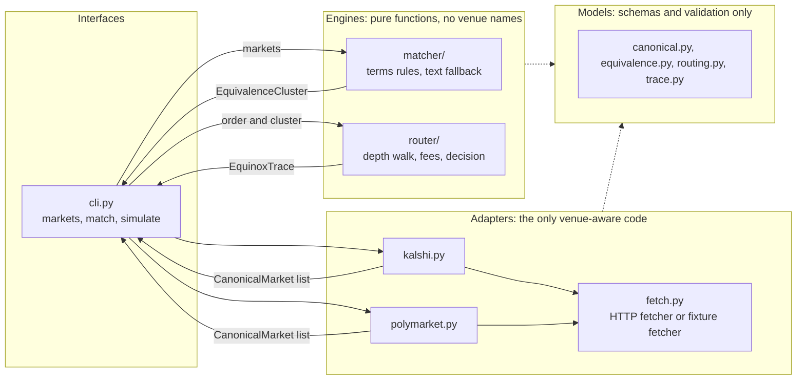
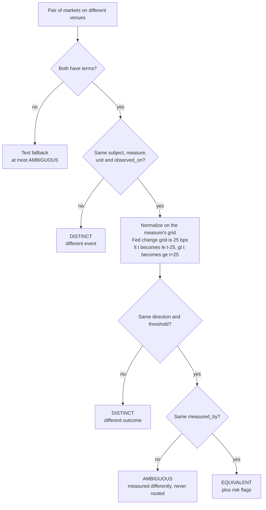
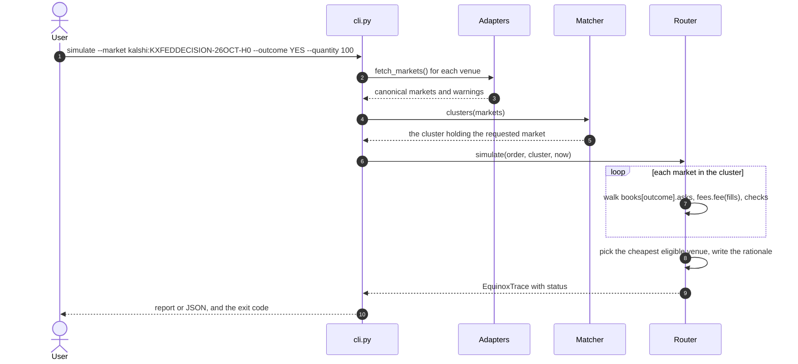

# Project Equinox: Architecture

**Revised 2026-10-10.** This replaces the first version written in the Antigravity session. The decisions behind it are D1–D30 in [DECISIONS.md](DECISIONS.md). The venue facts it relies on, each with a source and a label, are in [research/venue_facts.md](research/venue_facts.md). Each feature PRD in `docs/features/` names the sections it implements. When a PRD and this document disagree, this document wins, and the disagreement is a bug in the PRD.

---

## 1. Summary

Equinox is a command-line prototype. It does five things:

1. **Reads** prediction markets from two venues, Kalshi and Polymarket, through their live public APIs or a saved snapshot.
2. **Normalizes** each venue's response into one venue-neutral shape, the **canonical market**.
3. **Groups** markets that pay out under exactly the same conditions. It decides this by comparing their **contract terms**, not by how similar their titles are.
4. **Simulates** a buy order on every market in the group. For each one it walks the order book and adds that venue's fees, then picks the cheapest venue that can fill the whole order.
5. **Explains** the decision in a **trace**: which markets were matched and why, what each venue would cost, which venues were excluded and why, and what could still go wrong.

### Running example

"Will the Fed hold rates at its October 27–28, 2026 meeting?" This is Kalshi `KXFEDDECISION-26OCT-H0` and Polymarket market `2589812` ("No change"). All numbers below come from the snapshot taken at 2026-10-10T20:44:29Z, and `docs/research/running_example.py` reproduces them.

| Order | Kalshi | Polymarket | Decision |
|---|---|---|---|
| Buy 100 YES | 100 × $0.85 + $0.90 fee = **$85.90** | 100 × $0.84 + $0.672 fee = **$84.672** | Polymarket, $1.228 less |
| Buy 100 NO | 100 × $0.16 + $0.95 fee = **$16.95** | 100 × $0.17 + $0.7055 fee = **$17.7055** | Kalshi, $0.7555 less |
| Buy 5,000 NO | walks 2 price levels: average $0.1689, $49.14 fee = **$893.7951** | 5,000 × $0.17 + $35.275 fee = **$885.275** | Polymarket, $8.5201 less |

The last two rows give different answers for the same market. Kalshi's 16¢ price level holds fewer contracts than the order needs, so at 5,000 contracts the order spills onto its 17¢ level. Charging the fee on the average price instead of level by level, or ignoring depth, would pick the wrong venue.

### Third-venue check

Meridian, the user's binary-stock-outcome project, is **not integrated**. Section 9 checks that a venue like it would fit without changes to the matcher or the router. The check has two parts: a mapping on paper, and hand-built Meridian-like markets in the test data that go through the real matcher and router. Its example is "Will Apple (AAPL) close above $330 on October 12, 2026?", using the values of Polymarket market `5455686` and a Meridian-style `AAPL-330-2026-10-12`.

### Words used here

| Word | Meaning |
|---|---|
| Outcome | YES or NO. Each pays $1 per contract if it happens, otherwise $0. |
| Ask / bid | An ask is an offer to sell a contract at a price; a bid is an offer to buy one. |
| Level | One price in the order book and how many contracts are available at it. |
| Depth | The levels beyond the best price. Walking the book means filling the order from the cheapest ask upward. |
| Fill | The part of the order taken at one level: (price, quantity). |
| Average price | Total price paid divided by contracts filled, before fees. Often called VWAP. |
| Slippage | Average price minus the best ask. |
| Contract terms | What a market pays on: subject, measure, how it is measured, when, the comparison and the threshold (§4.4). |
| Cluster | A group of markets on different venues with the same terms. |
| Trace | The full record of one simulation (§8). |
| Fixture | A saved, unedited API response used instead of a live request. |

---

## 2. Scale and availability

One person runs one command on one machine. Nothing runs in the background and nothing is stored. Scale is therefore just the number of requests per run. A live run reads the tracked Fed event in **18 requests**:

- Kalshi: 1 series, 1 event and 5 order books.
- Polymarket: 1 event and 10 order books (two tokens per market, 5 markets).

The requests are made one at a time, each with a 10-second timeout. We did not research rate limits because 18 requests per run is too few to matter. The research snapshot also captured Polymarket's AAPL event, 29 requests in all, for the §9 test data. A future need for more events goes to batch endpoints: Kalshi `GET /markets/orderbooks`, and Polymarket's batch books endpoint.

**Availability.** If a venue fails, its markets come from the snapshot and the trace says so (D17). We run no load test, because there is no concurrency to test.

---

## 3. System overview



| Module | Owns | Rule it keeps |
|---|---|---|
| `models/` | Every shape that crosses a module boundary, plus its validation | No I/O and no venue names. Imports only the standard library and `pydantic`. |
| `adapters/` | Venue URLs, field names, units, sort orders, and the term parsers for each event family | Returns canonical markets that are fully normalized: prices in dollars between 0 and 1, both outcomes' books sorted best-first, terms filled in where the family is supported. Nothing downstream ever sees a venue field. |
| `matcher/` | Equivalence rules and clusters | Pure. Imports only `models/`. Contains no venue names. |
| `router/` | Depth walking, fees, eligibility, decision, rationale and trace | Pure. Imports only `models/`. Contains no venue names. The time comes in as an argument. |
| `cli.py` | Arguments, configuration, loading adapters, output, exit codes | The only place that wires modules together. |
| `server.py` | The existing status page and `/health` | Unchanged (D21). |

**Guard.** `tests/test_layering.py` parses the source of `matcher/` and `router/`. It fails if either imports anything outside `equinox.models`, the standard library or `pydantic`, or if the words "kalshi", "polymarket" or "meridian" appear in their code. This is how the brief's rule "routing logic should not contain venue-specific assumptions" is checked on every run.

**Stubs and seams.**
- **Fetching.** Adapters never call HTTP themselves. They get a `Fetcher`, and there are two: a live one (`urllib`) and a fixture one that looks the URL up in a snapshot's `index.json`. An adapter can't tell which one it has.
- **A new venue** plugs in as one adapter file, plus a fixture and an entry in `tracked_events.json`. Section 9 checks this against Meridian.
- **Time** is passed in (`now`) so that the staleness check and trace timestamps are deterministic in tests.

---

## 4. Canonical model

All of these live in `src/equinox/models/`. Every model is frozen (`ConfigDict(frozen=True, extra="forbid")`). Money and quantities are `Decimal`. Every datetime must carry a time zone and is stored in UTC.

### 4.1 Books and fees (`models/canonical.py`)

```python
Outcome = Literal["YES", "NO"]

class OrderBookLevel(Frozen):
    price: Decimal      # dollars per contract, 0 < price < 1
    quantity: Decimal   # contracts, > 0, fractional allowed

class OutcomeBook(Frozen):
    asks: tuple[OrderBookLevel, ...] = ()   # what it costs to BUY this outcome: cheapest first
    bids: tuple[OrderBookLevel, ...] = ()   # what you'd get to SELL it: highest first
    depth_complete: bool = True             # False if the venue returned only part of the book

class Fill(Frozen):
    price: Decimal
    quantity: Decimal

class FeeSchedule(Frozen):
    coefficient: Decimal        # >= 0. Kalshi 0.07 x series multiplier; Polymarket feeSchedule.rate; 0 = no fee
    exponent: int = 1           # >= 1
    rounding_step: Decimal      # > 0. Kalshi 0.01 (A3); Polymarket 0.00001

    def fee(self, fills: Sequence[Fill]) -> Decimal:
        """Round up, once, the sum over fills of coefficient x quantity x (price x (1 - price)) ** exponent."""
```

### 4.2 Supporting types

```python
class Collateral(Frozen):
    asset: str          # "USD", "USDC", "devnet USDC"
    has_value: bool     # False for test money (D24)

class ResolutionSource(Frozen):
    name: str
    url: str | None = None
    # institution: the URL's host without "www." (e.g. "federalreserve.gov"), else name.lower() (D18)
```

### 4.3 The market

```python
class CanonicalMarket(Frozen):
    market_id: str                   # "<venue>:<native_id>", e.g. "kalshi:KXFEDDECISION-26OCT-H0"
    venue: str                       # "kalshi" | "polymarket"; used for display only
    native_id: str
    event_id: str
    title: str                       # the venue's question, for display
    outcome_label: str               # e.g. "Fed maintains rate", "No change", "$330"
    rules_text: str = ""
    terms: ContractTerms | None      # None when the adapter has no parser for this family
    resolution_source: ResolutionSource
    collateral: Collateral
    tradable: bool                   # can an order be placed right now (D25)
    trading_closes_at: datetime | None
    resolves_at: datetime | None     # when the venue expects the outcome to be known
    captured_at: datetime            # when the book was read
    data_source: Literal["live", "fixture"]
    fees: FeeSchedule
    books: dict[Outcome, OutcomeBook]   # must contain "YES" and "NO" (D14)
    venue_metadata: dict[str, Any] = {}
```

### 4.4 Contract terms (D22)

```python
Comparison = Literal["gt", "ge", "lt", "le", "eq", "between"]

class ContractTerms(Frozen):
    subject: str                 # "FOMC", "AAPL"
    measure: str                 # "fed_upper_bound_change" | "close_price"
    measured_by: str             # "fomc_statement" | "pyth_regular_close" | "official_close"
    observed_on: date            # the date in New York (America/New_York)
    observed_at: datetime | None = None   # the exact instant, when the venue states one
    comparison: Comparison
    threshold: Decimal
    upper: Decimal | None = None # required for "between", forbidden otherwise
    unit: Literal["bps", "usd"]
    fallback_rules: tuple[str, ...] = ()  # the venue's edge-case rules in plain words
```

How markets map onto terms. The Fed rows are produced by the adapters from the snapshot. The two AAPL rows are hand-built test data for the §9 check; no adapter produces them.

| Market | subject | measure | measured_by | observed_on | comparison | threshold | unit |
|---|---|---|---|---|---|---|---|
| Kalshi `…-C26` "Cut >25bps" | FOMC | fed_upper_bound_change | fomc_statement | 2026-10-28 | lt | −25 | bps |
| Kalshi `…-C25` "Cut 25bps" | FOMC | fed_upper_bound_change | fomc_statement | 2026-10-28 | eq | −25 | bps |
| Kalshi `…-H0` "Fed maintains rate" | FOMC | fed_upper_bound_change | fomc_statement | 2026-10-28 | eq | 0 | bps |
| Kalshi `…-H25` / `…-H26` | FOMC | … | … | 2026-10-28 | eq / gt | 25 / 25 | bps |
| Polymarket "50+ bps decrease" | FOMC | fed_upper_bound_change | fomc_statement | 2026-10-28 | le | −50 | bps |
| Polymarket "25 bps decrease" / "No change" / "25 bps increase" | FOMC | … | … | 2026-10-28 | eq | −25 / 0 / 25 | bps |
| Polymarket "50+ bps increase" | FOMC | … | … | 2026-10-28 | ge | 50 | bps |
| §9 test data: Polymarket `5455686` "$330" | AAPL | close_price | pyth_regular_close | 2026-10-12, at 20:00Z | gt | 330 | usd |
| §9 test data: Meridian-style `AAPL-330-2026-10-12` | AAPL | close_price | pyth_regular_close | 2026-10-12, at 20:00Z | ge | 330 | usd |

### 4.5 Validation rules

These hold even if an adapter has a bug:

| Rule | Where | What it stops |
|---|---|---|
| 0 < price < 1, and quantity > 0 | `OrderBookLevel` | Cents not divided by 100; a zero-size level |
| Ask prices strictly rising and bid prices strictly falling | `OutcomeBook` | A book left in the venue's own order (both Kalshi and Polymarket list the best price last) |
| `books` has both YES and NO | `CanonicalMarket` | An adapter that forgot the NO side (D11) |
| `market_id == f"{venue}:{native_id}"` | `CanonicalMarket` | ID collisions across venues |
| Datetimes carry a time zone | all models | A naive time read as local time |
| `upper` is present exactly when the comparison is `between`, and is greater than `threshold` | `ContractTerms` | Malformed ranges |
| `coefficient >= 0`, `exponent >= 1`, `rounding_step > 0` | `FeeSchedule` | Negative or zero-step fees |
| JSON numbers are parsed as `Decimal` (`parse_float=Decimal`) | `Fetcher` | Polymarket's `feeSchedule.rate: 0.05` becoming the float 0.05000000000000000277 |

### 4.6 Money rules

- **Cost of an order on one venue:** total cost = Σ(fill price × fill quantity) + `fees.fee(fills)`. Every comparison uses full precision.
- **Fee:** one formula for every venue (D13). It is summed per level and rounded up once per order. The worked examples are the table in §1, and `running_example.py` reproduces them.
- **Display:** amounts in the text output are rounded to the cent, half up. If two totals round to the same cent, both are shown to 5 decimal places. `--json` prints the exact `Decimal` values as strings.

---

## 5. Adapters

### 5.1 Contract (`adapters/base.py`)

```python
Fetcher = Callable[[str], Any]      # URL -> parsed JSON (parse_float=Decimal); raises FetchError

@dataclass(frozen=True)
class AdapterResult:
    markets: list[CanonicalMarket]
    warnings: list[str]             # e.g. "kalshi: market X skipped: no parser for custom_strike {...}"

class VenueAdapter(ABC):
    venue: ClassVar[str]
    def __init__(self, fetch: Fetcher, tracked: list[TrackedEvent], data_source: Literal["live", "fixture"]): ...
    @abstractmethod
    def fetch_markets(self) -> AdapterResult: ...
```

`TrackedEvent` holds a venue's event ID (a Kalshi event ticker or a Polymarket slug) and its family. The only family with a term parser is `fed_decision`. Adding a family means adding one parser to each adapter that lists it. The tracked events are configured, not discovered (D28; see §11).

**Failures.** One market that fails validation is skipped, and a warning names it. A request that fails makes the CLI retry that whole venue with the fixture fetcher, and say so (D17). If the fixture is missing too, that venue contributes no markets and a warning.

### 5.2 Kalshi (`adapters/kalshi.py`)

**Requests:**
- `GET {base}/series/{series_ticker}`
- `GET {base}/events/{event_ticker}?with_nested_markets=true`
- `GET {base}/markets/{ticker}/orderbook`, once per market

The base URL is `https://external-api.kalshi.com/trade-api/v2` (K1).

| Canonical | From |
|---|---|
| native_id, event_id | `ticker`, `event_ticker` |
| title, outcome_label, rules_text | `title` (deprecated but returned; if missing, the event title plus `yes_sub_title`), `yes_sub_title`, `rules_primary` + `rules_secondary` |
| terms (`fed_decision`) | `custom_strike`: `{"Cut": "25"}` → eq −25; `{"Cut": ">25"}` → lt −25; `{"Hike": "0"}` → eq 0; `{"Hike": "25"}` → eq 25; `{"Hike": ">25"}` → gt 25. observed_on is the event's `strike_date` converted to the New York date. Fallback rule: "If the meeting is cancelled, 'Fed maintains rate' resolves Yes." Anything else → terms None, with a warning. |
| resolution_source | `series.settlement_sources[0]` (K7) |
| collateral | USD, has value |
| tradable | `status == "active"` |
| trading_closes_at, resolves_at | `close_time`, `expected_expiration_time` |
| fees | coefficient 0.07 × (event `fee_multiplier_override` if set, else series `fee_multiplier`), exponent 1, step 0.01 (K9, A3) |
| books (K4, K5) | YES asks = `no_dollars` at 1 − p, cheapest first. YES bids = `yes_dollars`, highest first. NO asks = `yes_dollars` at 1 − p. NO bids = `no_dollars`. An empty side is an empty book. |
| captured_at | When the orderbook response was read; the API gives no timestamp |

### 5.3 Polymarket (`adapters/polymarket.py`)

**Requests:**
- `GET {gamma}/events?slug={slug}`
- `GET {clob}/book?token_id={token}`, for both tokens of every market

| Canonical | From |
|---|---|
| native_id, event_id | market `id`, event `id` |
| title, outcome_label, rules_text | `question`, `groupItemTitle`, `description` |
| outcome tokens | `json.loads(outcomes)` must be `["Yes", "No"]`, or the market is skipped with a warning. The token IDs come from `json.loads(clobTokenIds)`, index 0 YES. For `version: "v2"` with null `clobTokenIds`, use `positionIds` (P1). |
| terms (`fed_decision`) | `groupItemTitle`: "N bps decrease" → eq −N; "N+ bps decrease" → le −N; "No change" → eq 0; "N bps increase" → eq N; "N+ bps increase" → ge N. observed_on is the last day of "scheduled for Month D1-D2, YYYY" in `description`; if that text is absent, `endDate` converted to the New York date, with a warning. Fallback rules: "A change not shown in the brackets is rounded up to the nearest 25 bps." and "If no statement is released by the end date of the next scheduled meeting, 'No change' resolves Yes." |
| resolution_source | `resolutionSource` (the name is the URL's host) |
| collateral | USDC, has value |
| tradable | `active and not closed and acceptingOrders` (P3) |
| trading_closes_at, resolves_at | None (Polymarket has no such field), `endDate` |
| fees | `feesEnabled` false → coefficient 0. Otherwise `feeSchedule.rate` and `feeSchedule.exponent`. Step 0.00001 (P7, P8). |
| books (P4, P5) | YES book from the YES token's `asks` and `bids`; NO book from the NO token's. Both are re-sorted best-first. The mirrored levels are never merged. |
| captured_at | The earlier of the two books' `timestamp` values (epoch milliseconds) |

---

## 6. Equivalence (`matcher/`)

**Definition (D8).** Two markets are equivalent if and only if holding YES on one pays out under exactly the same real-world conditions as holding YES on the other.

### 6.1 Rules (D23, applied in order to each cross-venue pair)



- **Direction** groups `gt` with `ge` as "above", and `lt` with `le` as "below". `eq` and `between` are their own groups. After grid normalization, a pair that differs only between `gt` and `ge` is "same direction and threshold".
- **Risk flags** are attached to an EQUIVALENT pair and copied into the trace:
  - **The strictness differs** (`gt` vs `ge`): "At exactly 330 USD, Polymarket pays No and Meridian pays Yes."
  - **Equal only on the grid:** "Equal only for moves in 25 bps steps."
  - **The fallback rules differ:** both venues' rules are listed.
  - **The resolution-source institutions differ** (D18).

### 6.2 Clusters

A cluster is every market whose normalized terms key is identical:

> (subject, measure, measured_by, observed_on, direction, normalized threshold, upper, unit)

A cluster may hold one market. By construction every pair inside a cluster is EQUIVALENT, and a test checks that. A cluster's `ambiguous` list holds the AMBIGUOUS pairs that involve its members. The trace shows them, but they are never routed.

### 6.3 Text fallback

Only markets without terms reach it, and the result can never be EQUIVALENT:
- Candidates are cross-venue pairs whose token Jaccard (shared words over all words, stop words removed) is at least 0.3.
- **Veto → DISTINCT:**
  - numbers differ, ignoring four-digit years from 1900–2099;
  - a known entity differs: US state names, month names, or a "cut" vs "hike" style pair from a small list.
- Every other candidate → AMBIGUOUS, with its score.

This part can be cut from the bottom of the build order (§12).

### 6.4 Labelled pairs (acceptance tests for feat-03)

| # | Pair | Expected |
|---|---|---|
| E1 | Kalshi H0 ↔ Polymarket "No change" | EQUIVALENT. Flag: fallback rules differ. |
| E2 | Kalshi C25 ↔ Polymarket "25 bps decrease" | EQUIVALENT. Flag: fallback rules differ. |
| E3 | Kalshi C26 (lt −25) ↔ Polymarket "50+ bps decrease" (le −50) | EQUIVALENT. Flags: equal only on the 25 bps grid; fallback rules differ. |
| E4 | Kalshi H26 (gt 25) ↔ Polymarket "50+ bps increase" (ge 50) | EQUIVALENT. Same flags as E3. |
| E5 | Kalshi H0 ↔ Polymarket "25 bps increase" | DISTINCT (different outcome) |
| E6 | Kalshi C25 ↔ Polymarket "50+ bps decrease" | DISTINCT (different outcome) |
| E7 | Meridian AAPL-330 ↔ Polymarket "$330" | EQUIVALENT. Flags: strictness (tie at 330 USD); fallback rules differ. |
| E8 | Meridian AAPL-330 ↔ Polymarket "$335" | DISTINCT |
| E9 | Meridian AAPL-330 on 2026-10-12 ↔ AAPL-330 on 2026-10-13 | DISTINCT (different event) |
| E10 | Same terms, `pyth_regular_close` vs `official_close` | AMBIGUOUS |
| E11 | Text: "Will the Fed cut rates by 25 bps in December 2025?" ↔ the same with 50 bps | DISTINCT (number veto, with "2025" ignored) |
| E12 | Text: "Will Trump win Pennsylvania in 2024?" ↔ "…Michigan in 2024?" | DISTINCT (entity veto) |
| E13 | Text: "Will the Fed cut rates at the December 2025 FOMC meeting?" ↔ "Fed decreases interest rates after December 2025 meeting?" | AMBIGUOUS, never EQUIVALENT |

E11–E13 are the three cases the first version's matching code got wrong (AI_USAGE items 2–4).

---

## 7. Routing (`router/`), the core flow

```python
def simulate(order: OrderRequest, cluster: EquivalenceCluster, now: datetime,
             stale_after: timedelta = timedelta(seconds=300), trace_id: str | None = None) -> EquinoxTrace
```



### 7.1 Each venue's quote

Every market in the cluster is simulated, including ones that will be excluded, so the trace can show what each venue would have cost.

1. **Walk** `books[outcome].asks` from the cheapest level: take min(remaining, level quantity) until the order is filled or the levels run out.
2. **Cost:** base = Σ price × quantity. fee = `fees.fee(fills)`. total = base + fee. Average price = base / filled. Slippage = average − best ask.
3. **Reasons the venue is excluded** (all that apply are recorded):
   - `NOT_TRADABLE`: `tradable` is false.
   - `TEST_MONEY`: `collateral.has_value` is false.
   - `EMPTY_BOOK`: there are no asks.
   - `PARTIAL_FILL`: filled < quantity.
   - `OVER_BUDGET`: the order is fully filled but total > `max_budget`.
4. **Warnings** (shown, but the venue stays eligible):
   - `STALE_DATA`: now − captured_at > `stale_after`.
   - `FIXTURE_DATA`: `data_source` is fixture.
   - `DEPTH_INCOMPLETE`: the walk ran out of levels on a book with `depth_complete` false.

### 7.2 Decision and status

| Situation | Status | Exit code |
|---|---|---|
| At least one venue is eligible. The winner has the lowest total, then the lower fee, then the lower `market_id`. | `ROUTED` | 0 |
| The requested `market_id` is not in the loaded markets (set by the CLI) | `MARKET_NOT_FOUND` | 1 |
| No venue is eligible, the cluster has a tradable real-money venue, and none of those can fill the whole order | `INSUFFICIENT_LIQUIDITY` | 2 |
| No venue is eligible, and at least one tradable real-money venue fills the whole order but is over budget | `BUDGET_EXCEEDED` | 3 |
| Bad arguments, such as a quantity of 0 or an unknown outcome (set by the CLI) | `INVALID_INPUT` | 4 |
| Every venue is excluded for `NOT_TRADABLE` or `TEST_MONEY` | `NO_ELIGIBLE_VENUE` | 5 |

**Savings.** The runner-up is the next eligible venue. Savings = runner-up total − winner total. Savings percent = savings / runner-up total × 100, rounded to 0.01.

**Rationale.** It names venues from the market's `venue` field and nothing else. For the running example (100 YES):

> Polymarket is the cheapest venue that can fill all 100 YES contracts: $84.67 including $0.67 in fees, versus $85.90 on Kalshi ($1.23 or 1.43% less). Match risks: Edge-case rules differ: Kalshi: if the meeting is cancelled, "Fed maintains rate" resolves Yes. Polymarket: a change not shown in the brackets is rounded up to the nearest 25 bps; if no statement is released by the end date of the next scheduled meeting, "No change" resolves Yes.

Each excluded venue adds one sentence, for example: "Meridian was not eligible: it settles in devnet USDC, which has no monetary value (it would cost $4.75)."

### 7.3 Every place it can break

| Breaks at | What happens | What the user sees | How it's settled |
|---|---|---|---|
| A venue request fails or times out | The CLI uses that venue's fixture (D17) | `FIXTURE_DATA` on that venue's quotes, plus a warning line | Rerun later with `--source live` |
| A response has an unexpected shape | That market fails validation and is skipped | "polymarket: market 2589812 skipped: …" | Fix the adapter; the golden tests catch it |
| A book arrives in the venue's order | The adapter re-sorts it; if it didn't, the model would reject it (§4.5) | Nothing, or the skip warning | — |
| Terms can't be parsed | terms None; the market reaches the text fallback only | It appears in `match` as AMBIGUOUS at best | Add a parser for that family |
| The book is empty | `EMPTY_BOOK` | "Kalshi was not eligible: nobody is selling NO" | — |
| The book is too thin | `PARTIAL_FILL`, status 2 if nothing else qualifies | "only 5 of 10 contracts are available" | — |
| Old data | `STALE_DATA` warning | The book's age, in the warning | — |
| Test money or a closed market | `TEST_MONEY` or `NOT_TRADABLE`, status 5 if nothing else qualifies | The reason sentence | — |

Nothing is written anywhere, so there is no double-submit, no locking and no partial state to guard against.

### 7.4 Demo inputs (snapshot fixtures, `--source fixtures`)

| Command arguments | Result |
|---|---|
| `--market kalshi:KXFEDDECISION-26OCT-H0 --outcome YES --quantity 100` | ROUTED to Polymarket, $84.672 vs $85.90 |
| `… -H0 --outcome NO --quantity 100` | ROUTED to Kalshi, $16.95 vs $17.7055 |
| `… -H0 --outcome NO --quantity 5000` | ROUTED to Polymarket, $885.275 vs $893.7951 (Kalshi used 2 levels) |
| `… -H0 --outcome YES --quantity 100 --budget 80` | BUDGET_EXCEEDED (exit 3) |
| `… -H0 --outcome YES --quantity 5000000` | INSUFFICIENT_LIQUIDITY (exit 2). Total YES ask depth is 4,649,443.27 on Kalshi and 3,453,123.38 on Polymarket. |
| `--market kalshi:KXFEDDECISION-26OCT-C25 --outcome NO --quantity 100` | ROUTED to Polymarket at $99.61992; Kalshi EMPTY_BOOK |
| `--market kalshi:NOPE --outcome YES --quantity 1` | MARKET_NOT_FOUND (exit 1) |
| `--market kalshi:KXFEDDECISION-26OCT-H0 --outcome YES --quantity 0` | INVALID_INPUT (exit 4) |

---

## 8. Trace and CLI contract

### 8.1 Trace (`models/routing.py`, `models/trace.py`)

```python
class OrderRequest(Frozen):
    market_id: str
    outcome: Outcome
    quantity: Decimal              # > 0
    max_budget: Decimal | None     # > 0 if set

class VenueQuote(Frozen):
    market_id: str
    venue: str
    eligible: bool
    reasons: tuple[QuoteReason, ...]      # NOT_TRADABLE, TEST_MONEY, EMPTY_BOOK, PARTIAL_FILL, OVER_BUDGET
    warnings: tuple[QuoteWarning, ...]    # STALE_DATA, FIXTURE_DATA, DEPTH_INCOMPLETE
    fills: tuple[Fill, ...]
    filled_quantity: Decimal
    best_ask: Decimal | None
    average_price: Decimal | None
    slippage: Decimal | None
    base_cost: Decimal
    fee: Decimal
    total_cost: Decimal

class Decision(Frozen):
    winner: str                    # market_id
    runner_up: str | None
    savings: Decimal | None
    savings_percent: Decimal | None

class EquinoxTrace(Frozen):
    trace_id: str
    created_at: datetime
    status: RoutingStatus
    order: OrderRequest | None
    cluster: EquivalenceCluster | None
    quotes: tuple[VenueQuote, ...]
    decision: Decision | None
    rationale: str
    assumptions: tuple[str, ...]   # A1, A2, A3, A5, worded for the reader
    warnings: tuple[str, ...]      # adapter warnings plus quote warnings, in plain words
```

The trace uses typed sections instead of the first version's generic "spans" (D30). Each section is a field that tests can assert on directly.

`models/equivalence.py` holds:
- `EquivalenceStatus` (EQUIVALENT, AMBIGUOUS, DISTINCT)
- `MatchResult(market_a, market_b, status, method: "terms" | "text", reasons, risk_flags, text_score)`
- `EquivalenceCluster(cluster_id, markets, pairs, ambiguous, risk_flags)`

### 8.2 CLI (`python -m equinox …`)

| Command | Prints |
|---|---|
| `markets [--source live\|fixtures] [--json]` | One line per canonical market: market_id, terms in words, tradable, best asks |
| `match [--source …] [--json]` | Clusters with their risk flags, then AMBIGUOUS pairs with their reasons |
| `simulate --market ID --outcome YES\|NO --quantity N [--budget B] [--source …] [--json]` | A report: status, the quote table, the decision, the rationale and warnings. `--json` prints the whole trace instead. The exit code is from §7.2. |

The default source is `live`. The demo commands in the README use `--source fixtures` so that their numbers match this document. `python -m equinox.server` keeps serving the status page.

---

## 9. Third-venue fit check: Meridian (D26)

Meridian is the user's binary-stock-outcome project: daily contracts on whether a stock closes at or above a strike, traded on Solana devnet. It is planned, not deployed, and **we are not integrating it**. The check asks a narrower question: if we did integrate a venue like it, would the matcher, the router and the shared model work unchanged? Meridian's facts are M1–M6 in `venue_facts.md`.

### 9.1 How an adapter would map it (on paper, not built)

The table assumes Meridian exposes HTTP endpoints like the other venues (A4): `GET /api/markets?day=` and `GET /api/markets/{key}/book`, with prices in whole cents and quantities in whole contracts. Only a Meridian adapter would depend on that shape.

| Canonical | Meridian source |
|---|---|
| native_id, event_id | `key` (`AAPL-330-2026-10-12`), `{ticker}-{day}` |
| terms | subject `ticker`, measure close_price, measured_by pyth_regular_close, observed_on `day`, observed_at the 4:00 PM ET close, comparison ge (M1: at or above), threshold `strike_cents` / 100, unit usd. Fallback rule: "If Pyth's confidence band straddles the strike, the market is held and an admin settles it on the official close." (M2) |
| collateral | devnet USDC, `has_value` false (M5) |
| tradable | the market is open and the program isn't paused |
| fees | coefficient 0 (M4) |
| books | YES asks = asks / 100. YES bids = bids / 100. NO asks = 1 − YES bids. NO bids = 1 − YES asks (M3: buying NO costs 100¢ − the YES bid). |

### 9.2 Result

| Part | Fits? | How |
|---|---|---|
| Adapter boundary | Yes | One adapter file, one fixture and one `tracked_events.json` entry. Nothing else changes. |
| Prices and quantities | Yes | Whole cents / 100 → `Decimal` between 0 and 1. Whole contracts. |
| YES and NO books (D14) | Yes | NO asks = 1 − YES bids, the same derivation the Kalshi adapter uses |
| Fees (D13) | Yes | coefficient 0. Solana transaction costs aren't modelled (DECISIONS, "Cut"). |
| Contract terms (D22) | Yes, because of D22 | "at or above $330 at the 4:00 PM ET close, per Pyth". Terms shaped around the Fed alone could not express it. |
| Equivalence (D23) | Yes | E7: EQUIVALENT to Polymarket's "$330", with the tie-rule and fallback flags |
| Money (D24) | Yes, because of D24 | devnet USDC has no value → TEST_MONEY. Without D24, A1 would treat play money as dollars. |
| Tradability (D25) | Yes, because of D25 | Meridian works out open and closed from the clock. Polymarket keeps trading past `endDate`. |
| Router | Unchanged | It reads only canonical fields |

### 9.3 Evidence that runs

The check counts only if it runs, so it is part of the test suite. No Meridian adapter is involved.

- `tests/golden/canonical_markets.json` (feat-01) includes hand-built **fit-check markets**:
  - Meridian-style AAPL-330 and AAPL-320 for 2026-10-12, mapped as in §9.1.
  - Polymarket's "$330" and "$335" AAPL markets, with values copied from the research snapshot.
  - The E9 and E10 variants.
- The **matcher** tests run E7–E10 on them (feat-03).
- The **router** tests run three cases on them (feat-04 tests 7–9):
  - 5 YES → Polymarket wins at $4.80768; Meridian TEST_MONEY, would cost $4.75.
  - 10 YES → Meridian also PARTIAL_FILL.
  - Meridian alone → NO_ELIGIBLE_VENUE.
- `test_layering.py` proves the matcher and router contain no venue names, so none of this needed engine changes.

---

## 10. Stack, testing and delivery

**Stack (D1).** Python 3.12, `pydantic` 2, and `tzdata`. `tzdata` is needed because Python on Windows has no time-zone database: `ZoneInfo("America/New_York")` raised `ZoneInfoNotFoundError` on this machine. The HTTP client and the server are the standard library's. The exact versions are pinned in `requirements.txt` by feat-01.

**Test layers.**

| Layer | What | Owner |
|---|---|---|
| Model rules | Every row of §4.5, plus the fee formula against the §1 numbers | feat-01 |
| Layering guard | `test_layering.py` (§3) | feat-01 |
| Adapter facts | Each adapter on the snapshot: counts, terms per market, best asks, total depth, fee coefficient, tradable, skip warnings | feat-02a/b |
| Matcher pairs | E1–E13 on the golden canonical markets, including the §9 fit-check markets | feat-03 |
| Router scenarios | §7.1–7.2 on the golden canonical markets: every reason, every status, the tie-break, the rationale text, and the §9 cases | feat-04 |
| End to end | Every row of §7.4 through `python -m equinox … --source fixtures`, checking the exit codes and numbers | feat-05 |

**Golden canonical markets.** `tests/golden/canonical_markets.json` holds hand-written canonical markets: the Fed pairs (E1–E6), the §9 fit-check markets (E7–E10), and the router cases. The books are trimmed to the top levels from the snapshot. The matcher and router lanes test against this file, so they don't wait for the adapters (D19).

**Gate.** `make gate` = `ruff check`, `ruff format --check`, `pytest`. It must pass on Windows (the Makefile currently uses `.venv/bin`, which workflow prep fixes) and in both CIs. No test touches the network.

---

## 11. Configuration

| Setting | Default | Notes |
|---|---|---|
| `--source` / `EQUINOX_SOURCE` | `live` | `fixtures` reads `src/equinox/fixtures/` |
| `KALSHI_BASE_URL` | `https://external-api.kalshi.com/trade-api/v2` | K1 |
| `POLYMARKET_GAMMA_URL`, `POLYMARKET_CLOB_URL` | `https://gamma-api.polymarket.com`, `https://clob.polymarket.com` | |
| `EQUINOX_STALE_AFTER_SECONDS` | 300 | §7.1 |
| `EQUINOX_HTTP_TIMEOUT_SECONDS` | 10 | |
| Tracked events | `src/equinox/tracked_events.json` | Per venue: event IDs and their family (D28). The defaults are the snapshot's events. |

---

## 12. Repository layout and build order

```
src/equinox/
  __main__.py            # python -m equinox -> cli.main
  cli.py
  server.py              # unchanged
  tracked_events.json
  fixtures/
    snapshot-2026-10-10/ # raw Kalshi and Polymarket responses + index.json (moved from docs/research/samples)
  models/   canonical.py  equivalence.py  routing.py  trace.py
  adapters/ base.py  fetch.py  kalshi.py  polymarket.py
  matcher/  terms.py  text.py  clusters.py
  router/   depth.py  engine.py  rationale.py
tests/
  golden/canonical_markets.json   # includes the §9 fit-check markets
  test_models.py  test_layering.py
  test_kalshi.py  test_polymarket.py
  test_matcher.py  test_router.py  test_cli.py
  test_equinox.py        # existing status-server tests
```

**Build order (D19).** Each lane owns only its own files.

| Step | Feature | Owns | Done when |
|---|---|---|---|
| 1 | feat-01 models and fixtures | `models/`, `adapters/base.py`, `adapters/fetch.py`, `fixtures/`, `tracked_events.json`, `tests/golden/`, `test_models.py`, `test_layering.py`, `requirements.txt` | `make gate` passes; the golden file validates against the models |
| 2 (parallel) | feat-02a Kalshi | `adapters/kalshi.py`, `test_kalshi.py` | Snapshot facts asserted |
| 2 | feat-02b Polymarket | `adapters/polymarket.py`, `test_polymarket.py` | Snapshot facts asserted |
| 2 | feat-03 matcher | `matcher/`, `test_matcher.py` | E1–E13 pass |
| 2 | feat-04 router | `router/`, `test_router.py` | Every reason, status and rationale case passes, including §9's |
| 3 | feat-05 CLI | `cli.py`, `__main__.py`, `test_cli.py` | Every row of §7.4 |
| 4 | feat-06 written deliverables | `README.md`, `docs/EQUIVALENCE.md`, `docs/ROUTING.md`, a final pass on `docs/AI_USAGE.md` | Every README command runs as written; the numbers match a fresh run |

**If time runs short, cut from the bottom:**
1. The text fallback (§6.3): pairs without terms are simply unmatched.
2. Live mode (fixtures only). The brief asks for API integration, so this is the last cut.

---

## 13. Known limitations

- **Tracked events are configured, not discovered (D28).** After 2026-10-28, live runs need the next Fed meeting's event IDs in `tracked_events.json`. Fixture runs are unaffected.
- **One event family has a term parser:** Fed rate decisions. Every other market is matched by text and is never routed. §9 shows that a second family, stock close-above, fits the same terms shape.
- **Fees are list fees.** Polymarket's taker rebates (up to 50%) and builder fees are ignored (A5).
- **Kalshi fees are rounded to the cent (A3).** Polymarket's rounding mode and per-fill granularity are unconfirmed (P8). In both cases the effect is under 1¢ per order.
- **Books are frozen at capture (A2).** There is no latency, no queue position and no market impact.
- **One order goes to one venue.** There is no split routing.
- **Meridian is not integrated.** §9 checks that it would fit.
- **"Up or Down" markets and Solana transaction costs are cut** (DECISIONS, "Cut").
