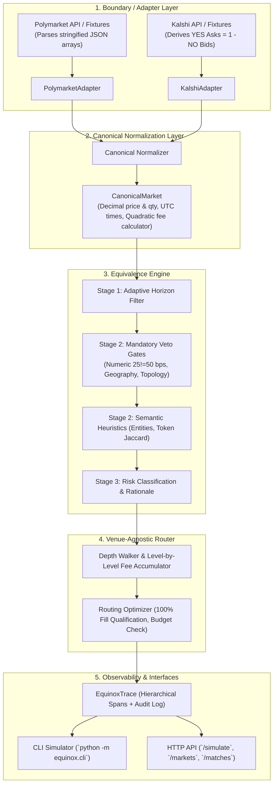

# Project Equinox: Product Requirements Document (PRD)

> **2026-10-10: partly superseded.** §1–§2 still describe the product, except that matching is by contract terms, not a scored pipeline (D15). The technical sections §3–§11 (models, adapters, matching, routing, trace schema, HTTP endpoints, layout, exit codes) are replaced by [architecture.md](architecture.md) and decisions D11–D30 in [DECISIONS.md](DECISIONS.md). Where this file and architecture.md disagree, architecture.md wins. The venue facts in §1.1 and §5 are corrected in [research/venue_facts.md](research/venue_facts.md).

---

## 1. Project Overview & Objectives

**Project Equinox** is an infrastructure prototype that connects to multiple prediction market platforms (**Polymarket** and **Kalshi**), normalizes their heterogeneous schemas into a canonical internal model, infers market equivalence across venues, and simulates intelligent, fee- and depth-aware order routing with auditable plain-English justifications.

### 1.1 The Problem
Prediction markets represent real-world event outcomes (e.g., elections, central bank decisions, economic indicators). However, venues are fragmented:
* **Symbology & Phrasing:** Kalshi uses structured tickers (e.g., `FED-25DEC-T4.50`) and CFTC regulatory descriptions; Polymarket uses natural-language questions (e.g., *"Will the Fed cut interest rates in December 2025?"*).
* **Pricing & Denomination:** Kalshi trades in fixed-point dollar strings ($0.0100 - 0.9900$) settling in USD; Polymarket trades in decimal fractions ($0.000 - 1.000$) settling in USDC on Polygon.
* **Resolution Oracles:** Kalshi resolves via designated U.S. government sources (e.g., BLS or Federal Reserve H.15 releases); Polymarket resolves via UMA Optimistic Oracle (decentralized token voting referencing consensus media).
* **Fee Structures:** Both venues employ non-linear quadratic variance taker fee models ($P(1-P)$) rather than flat volume percentages, requiring level-by-level accounting.

### 1.2 Core Objectives
1. **Venue Ingestion:** Connect to Polymarket (Gamma/CLOB) and Kalshi (v2) APIs with offline fixture fallback support.
2. **Canonical Normalization:** Map disparate data models into a unified, venue-agnostic representation using arbitrary-precision `Decimal` for all pricing and sizing.
3. **Synthetic Ask Reconstruction:** Reconstruct unified ask ladders for binary markets where exchanges quote bids only (e.g., Kalshi $P_{\text{YES ask}} = 1.00 - P_{\text{NO bid}}$).
4. **Equivalence Detection:** Detect whether contracts across venues represent the same underlying event using an adaptive 3-stage pipeline with mandatory numerical and structural **Veto Gates**.
5. **Venue-Agnostic Routing Simulation:** Simulate order execution across equivalent markets, walking order-book depth and accumulating non-linear fees level-by-level (avoiding Jensen's inequality error).
6. **Explainability & Audit Traces:** Emit human-auditable logs detailing matching confidence, settlement divergence risks, price comparisons, and selection rationales.
7. **Graceful Handling of Imperfect Data:** Gracefully handle missing order-book depth, temporal staleness, and ambiguous wording.

### 1.3 Out of Scope
* Real-money order execution and blockchain/smart-contract transactions.
* Wallet management, private key custody, and fiat banking rails.
* Regulatory compliance reporting and user identity (KYC/AML).
* Production web frontend / user interface.

---

## 2. Domain Realities & Documented Assumptions

Prediction markets differ fundamentally from standard stateless software. The system operates under the following documented assumptions:

```
┌─────────────────────────────────────────────────────────────────────────────────────────────┐
│                                   DOCUMENTED ASSUMPTIONS                                    │
├──────────────────────────────┬──────────────────────────────────────────────────────────────┤
│ 1. Snapshot Freeze           │ Market order books move in milliseconds. The simulation      │
│                              │ assumes all compared order books are frozen at the capture   │
│                              │ timestamp (`captured_at_utc`).                               │
├──────────────────────────────┼──────────────────────────────────────────────────────────────┤
│ 2. Pre-funded Capital Parity │ Assumes the hypothetical trader holds pre-funded capital     │
│                              │ in both USD and USDC at 1:1 parity ($1.00 USD = 1.00 USDC)  │
│                              │ with zero transfer friction or bridging latency.             │
├──────────────────────────────┼──────────────────────────────────────────────────────────────┤
│ 3. Resolution Basis Risk     │ The system does not guarantee 100% legal resolution parity.  │
│                              │ If oracle sources or resolution conditions differ, an        │
│                              │ explicit risk warning is logged in the audit trace.          │
├──────────────────────────────┼──────────────────────────────────────────────────────────────┤
│ 4. Outcome Polarity & Vetoes │ In binary markets, numerical strikes (25 vs 50 bps) or       │
│                              │ inverted questions must be vetoed immediately, preventing    │
│                              │ false matches caused by high superficial token similarity.   │
├──────────────────────────────┼──────────────────────────────────────────────────────────────┤
│ 5. Depth Depletion & Fees    │ Orders consume liquidity level-by-level up the order book.   │
│                              │ Non-linear fees ($P(1-P)$) are accumulated per fill level    │
│                              │ rather than approximated on aggregate VWAP.                  │
└──────────────────────────────┴──────────────────────────────────────────────────────────────┘
```

---

## 3. Architecture & Separation of Concerns

The architecture strictly decouples venue-specific mechanics from canonical business logic. The routing engine contains **zero venue-specific code**.



---

## 4. Canonical Data Models Specification

All canonical models are defined in `src/equinox/models/canonical.py` using Pydantic:

### 4.1 `OrderBookLevel` & `CanonicalOrderBook`
```python
from decimal import Decimal, ROUND_CEILING
from datetime import datetime
from typing import Any, Literal
from pydantic import BaseModel, Field

class OrderBookLevel(BaseModel):
    """A price level in an order book using arbitrary precision."""
    price: Decimal = Field(..., ge=Decimal("0.00"), le=Decimal("1.00"), description="Probability price [0.00, 1.00]")
    quantity: Decimal = Field(..., gt=Decimal("0.00"), description="Available contracts (supports fractional sizes)")

class CanonicalOrderBook(BaseModel):
    """Normalized order book with bids and asks."""
    bids: list[OrderBookLevel] = Field(default_factory=list, description="Bids sorted descending by price")
    asks: list[OrderBookLevel] = Field(default_factory=list, description="Asks sorted ascending by price")
    depth_available: bool = Field(default=True, description="False if venue only provided top quote")
```

### 4.2 `CanonicalFeeSchedule` (Accurate Non-Linear Accounting)
```python
class CanonicalFeeSchedule(BaseModel):
    """Encapsulates venue fee calculations so the router has zero venue if/else branches."""
    venue: str
    fee_type: Literal["fixed_per_contract", "percentage_volume", "quadratic_variance", "zero"]
    rate: Decimal = Field(default=Decimal("0.00"), ge=Decimal("0.00"))
    multiplier: Decimal = Field(default=Decimal("1.0"), ge=Decimal("0.00"))
    round_to_cents: bool = Field(default=False)

    def calculate_taker_fee(self, quantity: Decimal, price: Decimal) -> Decimal:
        """Computes dollar fee for executing quantity at a specific price level."""
        if self.fee_type == "quadratic_variance":
            # Real Kalshi and Polymarket fee model: C * rate * P * (1 - P)
            raw_fee = self.multiplier * self.rate * quantity * price * (Decimal("1.0") - price)
            if self.round_to_cents:
                # Kalshi regulatory ceiling round-up to nearest cent:
                return (raw_fee * Decimal("100")).to_integral_value(rounding=ROUND_CEILING) / Decimal("100")
            return raw_fee
        elif self.fee_type == "fixed_per_contract":
            return self.rate * quantity
        elif self.fee_type == "percentage_volume":
            return quantity * price * self.rate
        return Decimal("0.00")
```

### 4.3 `CanonicalMarket`
```python
class CanonicalMarket(BaseModel):
    """Universal market entity independent of venue schemas."""
    canonical_id: str
    venue: str
    native_id: str
    title: str
    description: str
    target_outcome: str = "YES"
    outcomes: list[str] = ["YES", "NO"]
    expiration_utc: datetime
    captured_at_utc: datetime
    fee_schedule: CanonicalFeeSchedule
    order_book: CanonicalOrderBook
    resolution_source: str
    
    # "Junk drawer" pattern: preserves venue-specific artifacts without polluting business logic
    venue_metadata: dict[str, Any] = Field(default_factory=dict)
```

---

## 5. Venue Ingestion & Adapters Specification

### 5.1 Polymarket Adapter (`PolymarketAdapter`)
* **API Endpoints:**
  * Gamma Markets API: `https://gamma-api.polymarket.com/markets`
  * CLOB Order Book API: `https://clob.polymarket.com/book?token_id={token_id}`
* **Normalization Logic:**
  * Deserializes stringified JSON arrays: `json.loads(market["clobTokenIds"])`, `json.loads(market["outcomes"])`.
  * Extracts outcome-specific token ID (`clobTokenIds[0]` for YES).
  * Prices normalized directly from decimal strings.
  * Fee model configured as `quadratic_variance` ($\Theta \approx 0.00 - 0.04$).
  * `venue_metadata`: Stores `condition_id`, `uma_oracle_address`, `market_slug`.

### 5.2 Kalshi Adapter (`KalshiAdapter`)
* **API Endpoints:**
  * Kalshi Markets API: `https://api.elections.kalshi.com/trade-api/v2/markets`
  * Kalshi Order Book API: `https://api.elections.kalshi.com/trade-api/v2/markets/{ticker}/orderbook`
* **Synthetic Ask Reconstruction (Crucial Microstructure Fix):**
  * Kalshi v2 returns BIDS ONLY (`yes_dollars` and `no_dollars`).
  * To buy YES, the adapter derives synthetic YES asks by inverting the NO bids:
    $$P_{\text{YES ask}} = \text{Decimal}("1.00") - P_{\text{NO bid}}, \quad Q_{\text{YES ask}} = Q_{\text{NO bid}}$$
    sorted ascending by ask price.
  * Fee model configured as `quadratic_variance` with rate `0.07`, `round_to_cents=True`.
  * `venue_metadata`: Stores `rules_primary`, `subtitle`, `series_ticker`.

### 5.3 Offline Fixture Fallback
* Static fixtures stored in `tests/fixtures/polymarket_markets.json` and `tests/fixtures/kalshi_markets.json`.
* Adapters default to fixture mode in test environments, guaranteeing 100% offline pass rate in CI.

---

## 6. Equivalence Detection Engine Specification

### 6.1 Definition of Equivalence
> **Two markets $M_A$ and $M_B$ are equivalent if and only if holding YES on $M_A$ pays out under the exact same real-world conditions as holding YES on $M_B$.**

### 6.2 Adaptive 3-Stage Pipeline with Veto Gates

```
Candidate Pair (M_A, M_B)
         │
         ▼
[Stage 1: Adaptive Horizon Filter]
├─ Same calendar month or event cycle?
│   ├─ Yes: Allow horizon delta up to ±31 days
│   └─ No:  Delta <= 24 hours required
└─ Passes? ──No──► REJECT (Time Horizon Mismatch)
         │ Yes
         ▼
[Stage 2A: Mandatory Veto Gates (Disqualifiers)]
├─ Metric Check: Extracted numbers differ? (25 bps != 50 bps) ──Yes──► REJECT (DISTINCT)
├─ Entity Check: Conflicting states/actors? (PA != MI)        ──Yes──► REJECT (DISTINCT)
└─ Payout Topology Check: Bracket vs Cumulative Threshold?    ──Yes──► REJECT (DISTINCT)
         │ Passes All Vetoes
         ▼
[Stage 2B: Semantic & Heuristic Scoring]
├─ Entity Overlap: Subject (Fed, Trump), Target (Cut, Win), Horizon (Dec 2025)
├─ Token Jaccard Overlap: J(Tokens_A, Tokens_B)
└─ Normalized Levenshtein Distance
         │ Compute Composite Score S
         ▼
[Stage 3: Classification & Risk Audit]
├─ If S >= 0.85: EQUIVALENT
├─ If 0.60 <= S < 0.85: AMBIGUOUS
└─ If S < 0.60: DISTINCT
         │ Attach Resolution Risk Flag if Oracle Sources Differ
         ▼
MatchResult (status, confidence, reasons, risk_flags)
```

### 6.3 Mathematical Scoring Formula
For candidate markets passing Stage 1 and all Stage 2A Veto Gates:

$$S = 0.50 \cdot S_{\text{entity}} + 0.30 \cdot S_{\text{token}} + 0.20 \cdot S_{\text{fuzzy}}$$

Where:
* $S_{\text{entity}} = \frac{|\text{Entities}_A \cap \text{Entities}_B|}{|\text{Entities}_A \cup \text{Entities}_B|}$
* $S_{\text{token}} = \frac{|\text{Tokens}_A \cap \text{Tokens}_B|}{|\text{Tokens}_A \cup \text{Tokens}_B|}$
* $S_{\text{fuzzy}} = \text{Levenshtein Ratio}(\text{Title}_A, \text{Title}_B)$

---

## 7. Venue-Agnostic Routing Simulator Specification

### 7.1 Order Execution Simulation Algorithm

Given order request: `outcome: YES`, `quantity: N`, `max_budget: B`:

For each candidate equivalent market $M$:
1. **Depth Walking & Level-by-Level Fee Accumulation:**
   Initialize: $\text{remaining} = N$, $\text{base\_cost} = 0$, $\text{total\_fee} = 0$.
   For each ask level $(P_i, Q_i)$ in `M.order_book.asks`:
   * $\text{take} = \min(\text{remaining}, Q_i)$
   * $\text{base\_cost} += \text{take} \times P_i$
   * $\text{level\_fee} = M\text{.fee\_schedule.calculate\_taker\_fee}(\text{take}, P_i)$
   * $\text{total\_fee} += \text{level\_fee}$
   * $\text{remaining} -= \text{take}$
   * If $\text{remaining} == 0$, break.
2. **Liquidity Qualification Rule:**
   * If $\text{remaining} > 0$: Mark `fill_status = PARTIAL` ($N_{\text{filled}} < N$). **Disqualified from winning venue selection.**
   * If $\text{remaining} == 0$: Mark `fill_status = COMPLETE` ($100\%$ fill).
3. **VWAP & Slippage:**
   $$\bar{P} = \frac{\text{base\_cost}}{N_{\text{filled}}}, \quad \text{Slippage} = \bar{P} - P_{\text{best\_ask}}$$
4. **Total Net Cost & Budget Check:**
   $$\text{Total Net Cost} = \text{base\_cost} + \text{total\_fee}$$
   If $\text{Total Net Cost} > B$, mark `status = BUDGET_EXCEEDED` and disqualify.
5. **Winning Selection:**
   * Filter candidates to those with `fill_status == COMPLETE` and $\text{Cost} \le B$.
   * Select $\arg\min(\text{Total Net Cost})$.
   * If no candidate achieves 100% fill, abort selection, return `INSUFFICIENT_LIQUIDITY`, emit CLI exit code `2`, and report side-by-side partial fill stats.

### 7.2 Decision Selection & Rationale Template
The router evaluates all qualified candidate venues and generates an auditable sentence:
> *"{Winner} was selected because its total net cost after fees is \${Cost_Winner:.2f} vs \${Cost_Competitor:.2f} on {Competitor} (\${Savings:.2f} / {Percent:.1f}% savings). {Winner} offered a lower effective VWAP (\${VWAP_Winner:.3f} vs \${VWAP_Competitor:.3f}) and {FeeComparison}."*

---

## 8. Observability & Audit Trace Schema (`EquinoxTrace`)

The system records an OpenTelemetry-aligned execution trace for every simulation run:

```json
{
  "trace_id": "trace-equinox-20261010-001",
  "timestamp_utc": "2026-10-10T14:00:00Z",
  "order": {
    "target_event": "Fed Rate Cut December 2025",
    "outcome": "YES",
    "quantity": "100.0",
    "max_budget": "100.00"
  },
  "assumptions": [
    "Frozen order book snapshots at capture timestamp",
    "Pre-funded capital parity ($1.00 USD = 1.00 USDC)",
    "Level-by-level non-linear taker fee schedules applied"
  ],
  "resolution_risk_summary": "Kalshi settles on official FOMC release; Polymarket on UMA consensus.",
  "spans": [
    {
      "span_id": "span-1-equivalence",
      "step": "equivalence_detection",
      "inputs": {
        "market_a": "POLY-0x89ab",
        "market_b": "KALSHI-KXFED-25DEC"
      },
      "outputs": {
        "status": "EQUIVALENT",
        "confidence": 0.94,
        "matched_entities": ["Federal Reserve", "December 2025", "Interest Rate Cut"],
        "veto_gates_passed": true,
        "risk_flags": [
          "Resolution source divergence: Kalshi settles on FOMC release, Polymarket on UMA consensus."
        ]
      }
    },
    {
      "span_id": "span-2-venue-simulation-polymarket",
      "step": "venue_simulation",
      "venue": "polymarket",
      "outputs": {
        "best_ask": "0.4800",
        "vwap": "0.4800",
        "slippage": "0.0000",
        "base_cost": "48.00",
        "fee": "0.00",
        "total_net_cost": "48.00",
        "fill_percentage": 100.0,
        "fee_model_applied": "quadratic_variance"
      }
    },
    {
      "span_id": "span-3-venue-simulation-kalshi",
      "step": "venue_simulation",
      "venue": "kalshi",
      "outputs": {
        "best_ask": "0.5000",
        "vwap": "0.5000",
        "slippage": "0.0000",
        "base_cost": "50.00",
        "fee": "1.75",
        "total_net_cost": "51.75",
        "fill_percentage": 100.0,
        "fee_model_applied": "quadratic_variance"
      }
    },
    {
      "span_id": "span-4-routing-decision",
      "step": "decision_selection",
      "outputs": {
        "selected_venue": "polymarket",
        "dollar_savings": "3.75",
        "percent_savings": "7.25",
        "plain_english_rationale": "Polymarket was selected because its total net cost after fees is $48.00 vs $51.75 on Kalshi ($3.75 / 7.2% savings). Polymarket had a lower quoted ask ($0.48 vs $0.50) and zero taker fees (vs $1.75 quadratic variance fee on Kalshi)."
      }
    }
  ]
}
```

---

## 9. Interfaces: CLI and HTTP Endpoints

### 9.1 CLI Interface (`src/equinox/cli.py`)
```bash
python -m equinox.cli simulate \
  --event "Fed rate cut December 2025" \
  --outcome YES \
  --quantity 100 \
  --budget 75
```
**Exit Codes:**
* `0`: Simulation succeeded, winning decision rendered.
* `1`: No equivalent markets found.
* `2`: Insufficient liquidity across all candidate venues.
* `3`: Budget exceeded across all candidate venues.
* `4`: Invalid input parameters.

### 9.2 HTTP Server Endpoints (`src/equinox/server.py`)
* `GET /health`: Returns `{ "status": "ok", "version": "0.1.0", "hosts": ["github", "gitlab"] }`.
* `GET /api/v1/markets`: Lists normalized canonical markets from all loaded venues.
* `GET /api/v1/matches`: Lists detected equivalent market clusters with confidence scores.
* `POST /api/v1/simulate`: Accepts order JSON and returns full `EquinoxTrace` response.

---

## 10. Codebase Structure & Directory Layout

```
project-equinox/
├── docs/
│   ├── prd.md                    # This document (PRD)
│   └── architectural_review.md   # Independent peer review report
├── user/
│   └── users.md                  # User personas, stories, and workflows
├── src/
│   └── equinox/
│       ├── __init__.py           # Package version and health check
│       ├── __main__.py           # Entrypoint
│       ├── server.py             # HTTP status server & REST API
│       ├── cli.py                # Command-line interface simulator
│       ├── models/
│       │   ├── __init__.py
│       │   ├── canonical.py      # CanonicalMarket, CanonicalOrderBook, CanonicalFeeSchedule
│       │   ├── equivalence.py    # MatchResult, EquivalenceStatus
│       │   └── trace.py          # EquinoxTrace, TraceSpan
│       ├── adapters/
│       │   ├── __init__.py
│       │   ├── base.py           # BaseVenueAdapter abstract base class
│       │   ├── polymarket.py     # PolymarketAdapter (stringified JSON parsing)
│       │   └── kalshi.py         # KalshiAdapter (synthetic ask reconstruction)
│       ├── matcher/
│       │   ├── __init__.py
│       │   ├── pipeline.py       # Adaptive 3-Stage Equivalence Pipeline
│       │   └── scoring.py        # Veto gates, Entity, Token Jaccard, and Fuzzy similarity math
│       └── router/
│           ├── __init__.py
│           ├── engine.py         # Venue-agnostic Order Routing Simulator
│           └── depth.py          # Order book depth walker & level-by-level fee accumulator
├── tests/
│   ├── fixtures/
│   │   ├── polymarket_markets.json
│   │   ├── polymarket_books.json
│   │   ├── kalshi_markets.json
│   │   └── kalshi_books.json
│   ├── test_equinox.py           # Existing server and health tests
│   ├── test_canonical_models.py  # Model validation & fee calculation tests
│   ├── test_adapters.py          # Ingestion & normalization tests
│   ├── test_equivalence.py       # Matching, scoring, veto gates, and risk tests
│   └── test_router.py            # Depth walking, level-by-level fees, and trace tests
├── Makefile                      # make gate (ruff + pytest)
├── pyproject.toml
└── requirements.txt
```

---

## 11. Verification & Quality Gates

* **Zero External Network Calls in CI:**
  All tests must execute against offline JSON fixtures in `tests/fixtures/`.
* **Verification Command:**
  ```bash
  make gate
  ```
  Must run:
  1. `ruff check .` with zero lint errors.
  2. `ruff format --check .` with zero formatting errors.
  3. `pytest` with 100% test pass rate.
