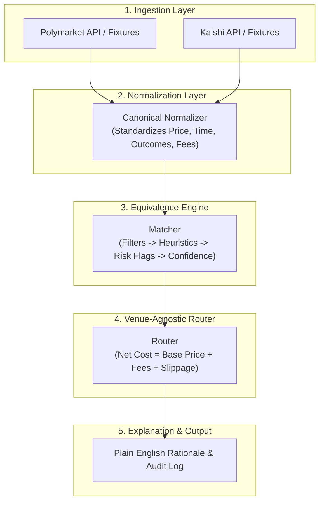

# Project Equinox: Domain Users, Core Questions & System Requirements

## 1. What Problem Are We Solving?

Prediction markets (websites where people trade on the outcomes of real-world events, like elections or economic decisions) are fragmented:
* **Different naming:** Kalshi's market for "the Fed holds rates in October 2026" is `KXFEDDECISION-26OCT-H0`, titled "Fed maintains rate". Polymarket's is market `2589812`, "Will there be no change in Fed interest rates after the October 2026 meeting?".
* **Different contract structures & pricing:** Kalshi lists only bids, and you buy YES at $1.00 minus the best NO bid. Polymarket has a separate order book for each outcome. Each venue charges its own fee.
* **Different rules & expiration times:** Kalshi's October Fed market stops trading at 1:59 PM ET on decision day. Polymarket gives 11:59 PM ET as the time its market becomes eligible to resolve. The venues also handle edge cases differently, such as a cancelled meeting or a rate change that isn't a multiple of 25 bps.

Because of this fragmentation, anyone trying to compare prices or place trades across venues faces major obstacles.

**Project Equinox builds an infrastructure prototype that:**
1. Connects to two venues (Polymarket and Kalshi), and is designed so that a third venue, such as the user's binary-stock-outcome project Meridian, would fit without changing the matcher or router (architecture §9).
2. Translates their data into a single, shared internal format (**Canonical Model**).
3. Detects if two markets on different venues refer to the same real-world event (**Equivalence Detection**).
4. Simulates placing a hypothetical order and picks the best venue (**Routing Engine**).
5. Explains every matching and routing decision in plain English (**Audit & Explainability**).

---

## 2. Who Are the Real Users of This System?

Instead of looking at software developers or evaluators, we look at the people and systems that actually need cross-venue prediction market infrastructure:

### User 1: The Unified Market Trader ("Jordan")
* **Who they are:** A person who wants to trade on real-world events without having to monitor multiple separate apps.
* **Their Problem:** They want to buy 100 YES contracts on an event, but don't want to manually calculate exchange fees, convert pennies to USDC, or check whether Kalshi or Polymarket is cheaper.
* **What they need from Equinox:** 
  * "Tell me which venue gives me the best net price for my order, and explain why."

### User 2: The Automated Client / Trading Algorithm ("AutoTrader")
* **Who they are:** A programmatic client or broker API that needs to execute orders automatically across multiple platforms.
* **Their Problem:** Writing custom exchange logic for every single venue creates spaghetti code. They need a single, clean API that accepts a generic order and routes it intelligently.
* **What they need from Equinox:**
  * Clean, venue-agnostic order routing, available as machine-readable output (`simulate --json` prints the full trace; D21).
  * Consistent data models where prices, outcomes, and fees are normalized.

### User 3: The Risk & Settlement Auditor ("Morgan")
* **Who they are:** An analyst responsible for verifying that trades don't take on hidden settlement risks.
* **Their Problem:** Two markets might sound similar in their titles, but resolve on different rules (e.g. one follows an official government report, while the other follows a media consensus). If they are treated as identical, a trader could lose everything.
* **What they need from Equinox:**
  * A clear, explainable audit trail showing *why* the system declared two markets equivalent.
  * Explicit confidence scores and risk warnings for ambiguous markets.

---

## 3. The 4 Core Architectural Questions the System Must Answer

The project instructions highlight four critical architectural challenges. Here is how our system is designed to solve them:

### Question 1: How do we strictly separate concerns so the routing engine has ZERO venue-specific assumptions?
* **The Danger:** If the routing engine contains code like `if venue == "kalshi": add_1_cent()`, the system is tightly coupled and cannot scale to new venues.
* **Our Architecture:**
  1. **Venue Adapters (Boundary Layer):** Dedicated modules (`PolymarketAdapter`, `KalshiAdapter`) that know how to talk to venue APIs and read venue-specific JSON fields.
  2. **Canonical Normalizer:** Converts raw venue data into a standard `CanonicalMarket` model:
     * Prices normalized to probabilities: $P \in [0.00, 1.00]$.
     * Outcomes normalized to: `YES` / `NO`.
     * Timestamps normalized to: UTC ISO-8601 datetimes.
     * Fees normalized into one formula for every venue: coefficient × contracts × p(1−p), summed per price level (D13).
     * Contract terms normalized into one shape: what is measured, how, when, the comparison and the threshold (D22).
  3. **Routing Engine:** Receives only `CanonicalMarket` objects. It compares candidates purely by net cost, liquidity, and execution impact. It **never checks venue names or venue-specific logic**.

### Question 2: What does "Equivalent" mean, and what is our matching methodology?
* **Our Definition of Equivalence:**
  > Two markets are **equivalent** if and only if **holding YES on Venue A pays out under the exact same real-world conditions as holding YES on Venue B.**
* **Our Matching Methodology (structured terms first, text as a fallback; architecture §6):**
  1. **Read the terms.** Each adapter turns a market into the same shape. Kalshi "Cut 25bps" and Polymarket "25 bps decrease" both become "FOMC upper-bound change = −25 bps, decided 2026-10-28, per the FOMC statement".
  2. **Compare the terms field by field.**
     * A different subject, date, outcome or threshold → `DISTINCT`.
     * Measured a different way, such as Pyth's price vs the official close → `AMBIGUOUS`, never routed.
     * Equal → `EQUIVALENT`, plus a risk flag for anything left over. For example, in the third-venue check, at exactly $330 a Meridian-style market pays Yes and Polymarket pays No.
  3. **Text fallback.** Markets we have no term parser for are compared by title. The best result is `AMBIGUOUS`, never `EQUIVALENT`. We tried title similarity as the main method, and it called "25 bps" vs "50 bps" equivalent (AI_USAGE 2–4).
  * Every decision comes with plain-English reasons and risk flags.

### Question 3: How does the routing engine evaluate venues and clearly explain its decision?
* The project brief emphasizes:
  > *"We are less concerned with optimizing execution quality than with understanding the reasoning and structure behind the decision."*
* **Evaluation Steps for a Hypothetical Order (`Buy N contracts`):**
  1. Inspect available liquidity (order book depth) on each candidate venue.
  2. Calculate base cost from quoted prices.
  3. Add venue-specific fees using the normalized fee model.
  4. Calculate the **Total Net Cost**.
* **Explanation Output:**
  The system produces a clear, auditable summary:
  ```text
  Order: buy 100 YES, "Fed holds rates in October 2026" (snapshot 2026-10-10T20:44Z)
  Selected venue: Polymarket, $84.67 total (vs $85.90 on Kalshi)
  Rationale:
    "Polymarket is the cheapest venue that can fill all 100 YES contracts: $84.67
     including $0.67 in fees, versus $85.90 on Kalshi ($1.23 or 1.43% less)."
  ```
  For 100 NO the answer flips to Kalshi ($16.95 vs $17.71). For 5,000 NO it flips back to Polymarket, because Kalshi's cheapest level runs out (architecture §1).

### Question 4: How does the system handle imperfect or ambiguous data gracefully?
* **Thin or missing order books:** An empty book or one too thin to fill the order makes that venue ineligible, and the trace says why ("only 5 of 10 contracts are available"). If a venue returned only part of its book, the quote is marked `DEPTH_INCOMPLETE`.
* **Unavailable venues and old data:** If a live request fails, that venue's saved snapshot is used and the trace says `FIXTURE_DATA`. A book more than 5 minutes old is marked `STALE_DATA`.
* **Test money and closed markets:** A venue settling in money with no value (such as devnet USDC), or a market that can't be traded now, is shown with its cost but can't win.
* **Ambiguous matches:** Markets measured differently, or matched only by title, are labelled `AMBIGUOUS` and never routed.
* **Documented assumptions:** The trace lists them: 1 USD = 1 USDC for collateral with value, books frozen at capture, Kalshi fees rounded to the cent, list fees without rebates (A1–A5).

---

## 4. Summary of System Workflows


